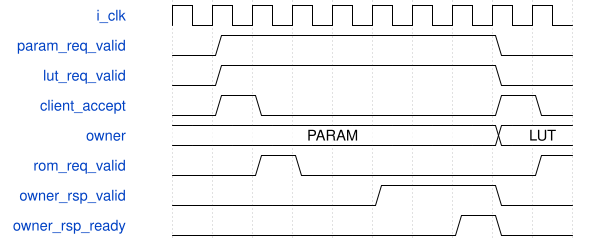

# road_rom_two_client_arbiter 模块规范

> RTL: `rtl/road_rom_two_client_arbiter.v`

## 1. 模块目的

未提供模块目的。

## 2. 参数

| 参数 | 默认值 | 说明 |
| --- | --- | --- |
| — | — | 本模块没有可配置参数。 |

## 3. 时钟与复位

- 时钟：`{"name": "i_clk", "frequency_hz": 100000000}`
- 复位：`{"name": "i_rstn", "assert": "async_low", "release": "local_sync_two_flops_or_owner_gating"}`

## 4. 接口信号规范

| 信号 | 方向 | 位宽 | 时钟域 | 语义角色 | 描述 |
| --- | --- | --- | --- | --- | --- |
| `i_clk` | input | 1 | i_clk | clk | 统一100MHz上升沿时钟 |
| `i_rstn` | input | 1 | i_clk | rstn | 共同低有效异步复位，本地两级同步释放 |
| `i_param_request_valid` | input | 1 | i_clk | param_request_valid | param_request_valid：按requirements中对应事务/计数合同使用 |
| `i_param_request_addr` | input | 13 | i_clk | param_request_addr | param_request_addr：按requirements中对应事务/计数合同使用 |
| `i_param_response_ready` | input | 1 | i_clk | param_response_ready | param_response_ready：按requirements中对应事务/计数合同使用 |
| `i_lut_request_valid` | input | 1 | i_clk | lut_request_valid | lut_request_valid：按requirements中对应事务/计数合同使用 |
| `i_lut_request_addr` | input | 13 | i_clk | lut_request_addr | lut_request_addr：按requirements中对应事务/计数合同使用 |
| `i_lut_response_ready` | input | 1 | i_clk | lut_response_ready | lut_response_ready：按requirements中对应事务/计数合同使用 |
| `i_rom_request_ready` | input | 1 | i_clk | rom_request_ready | 现有reader允许锁定一个13位物理词地址 |
| `i_rom_response_valid` | input | 1 | i_clk | rom_response_valid | reader完整160位响应有效，不携带标签 |
| `i_rom_response_data` | input | 160 | i_clk | rom_response_data | 低8位对应物理词第0字节的160位载荷 |
| `i_rom_fault` | input | 1 | i_clk | rom_fault | reader粘滞故障，只由共同复位清除 |
| `o_param_request_ready` | output | 1 | i_clk | param_request_ready | param_request_ready：按requirements中对应事务/计数合同使用 |
| `o_param_response_valid` | output | 1 | i_clk | param_response_valid | param_response_valid：按requirements中对应事务/计数合同使用 |
| `o_param_response_data` | output | 160 | i_clk | param_response_data | param_response_data：按requirements中对应事务/计数合同使用 |
| `o_lut_request_ready` | output | 1 | i_clk | lut_request_ready | lut_request_ready：按requirements中对应事务/计数合同使用 |
| `o_lut_response_valid` | output | 1 | i_clk | lut_response_valid | lut_response_valid：按requirements中对应事务/计数合同使用 |
| `o_lut_response_data` | output | 160 | i_clk | lut_response_data | lut_response_data：按requirements中对应事务/计数合同使用 |
| `o_rom_request_valid` | output | 1 | i_clk | rom_request_valid | 唯一ROM读口请求有效，等待ready时词地址保持 |
| `o_rom_request_addr` | output | 13 | i_clk | rom_request_addr | 20字节物理词号，合法0至7167 |
| `o_rom_response_ready` | output | 1 | i_clk | rom_response_ready | 消费当前ROM读响应；取消排空也必须握手 |
| `o_fault` | output | 1 | i_clk | fault | 本组件故障状态，不得发布为成功表 |

## 5. 周期行为与延迟

- One client valid&&ready latches owner and addr13 into single transaction slot; a registered ROM request is forwarded next cycle. Admission is distinct from physical reader acceptance.
- Only owner response valid&&ready releases transaction; reader return payload/valid routed only to owner. No OR ready, no broadcast return.
- Initial preference parameter client; after each admitted request preference switches to other owner. Sole requester wins regardless of preference. At most one other admitted request can bypass a continuously pending client, conditional on eventual physical ready/return and owner-ready.
- No arbiter cancel port. Existing LUT service drains logical ROM transaction accepted by arbiter, including queued-before-physical-read. Arbiter never clears owner on cancellation.
- Sticky global fault on reader fault or illegal FSM; owner not falsely retired. Original prefetch has no ROM fault input: expose global fault and require common reset; do not fabricate a successful response.

## 6. WaveDrom 时序图

### 请求所有权与停顿

客户端接受和物理reader接受分拍；图省略reader实际等待。owner响应保持到消费才允许下一客户，不能以非owner ready释放。

- WaveJSON：[road_rom_two_client_arbiter_request-hold-response.json5](waveforms/road_rom_two_client_arbiter_request-hold-response.json5)

## 7. 边界、反压与错误

- 复位、取消、背压、非法身份和边界地址；取消不能当成无标签外设已排空

## 8. CDC 与综合约束

- Verilog-2001；一个未决事务；ready/valid握手；无TD/物理时序签核
- 不改变冻结算术核/数值，不复制公共存储

## 9. 验证与验收

- both continuous requesters alternate
- single requester without starvation
- owner held while response backpressured
- nonowner ready cannot retire
- request address stable
- true down2 parameters and SiLU versus frozen manifest
- dynamic sigmoid1024/exp256 while prefetch active
- random client sink backpressure
- LUT cancel before admission and after admission late return
- new token isolation
- common reset during ownership/response

## 10. 可追溯性

- 规格模块：`road_rom_two_client_arbiter`
- RTL 路径：`rtl/road_rom_two_client_arbiter.v`
- 交付要求：本文档、WaveJSON 和 SVG 必须与同一版本规格一同发布。
