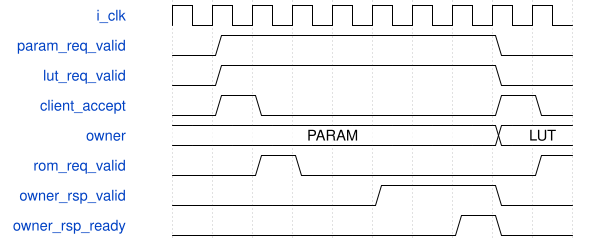

# road_rom_two_client_top 模块规范

> RTL: `rtl/road_rom_two_client_top.v`

## 1. 模块目的

未提供模块目的。

## 2. 参数

| 参数 | 默认值 | 说明 |
| --- | --- | --- |
| — | — | 本模块没有可配置参数。 |

## 3. 时钟与复位

- 时钟：`{"name": "i_clk", "frequency_hz": 100000000}`
- 复位：`{"name": "i_rstn", "assert": "async_low", "release": "local_sync_two_flops_or_owner_gating"}`

## 4. 接口信号规范

| 信号 | 方向 | 位宽 | 时钟域 | 语义角色 | 描述 |
| --- | --- | --- | --- | --- | --- |
| `i_clk` | input | 1 | i_clk | clk | 统一100MHz上升沿时钟 |
| `i_rstn` | input | 1 | i_clk | rstn | 共同低有效异步复位，本地两级同步释放 |
| `i_cancel` | input | 1 | i_clk | cancel | 取消当前查表，已接受的ROM读必须排空后再接新任务 |
| `i_lut_req_valid` | input | 1 | i_clk | lut_req_valid | 查表请求有效，等待ready时所有请求字段保持 |
| `i_lut_req_kind` | input | 1 | i_clk | lut_req_kind | 0为sigmoid，1为exp |
| `i_lut_req_address` | input | 10 | i_clk | lut_req_address | 表内索引；exp只允许0至255 |
| `i_lut_req_tag` | input | 16 | i_clk | lut_req_tag | 16位请求标签，响应原样回显 |
| `i_lut_req_frame_token` | input | 32 | i_clk | lut_req_frame_token | 请求源帧任务标识，响应回显 |
| `i_lut_req_model_id` | input | 32 | i_clk | lut_req_model_id | 绑定完整模型payload的32位模型标识 |
| `i_lut_rsp_ready` | input | 1 | i_clk | lut_rsp_ready | 本拍允许消费一次完整查表响应 |
| `i_load_ready` | input | 1 | i_clk | load_ready | load_ready：按requirements中对应事务/计数合同使用 |
| `i_table_ready` | input | 1 | i_clk | table_ready | table_ready：按requirements中对应事务/计数合同使用 |
| `o_lut_req_ready` | output | 1 | i_clk | lut_req_ready | 空闲且无旧ROM在途时允许一次查表传输 |
| `o_lut_rsp_valid` | output | 1 | i_clk | lut_rsp_valid | 查表完整响应有效，等ready时身份与数据保持 |
| `o_lut_rsp_kind` | output | 1 | i_clk | lut_rsp_kind | 回显已接受请求的表类别 |
| `o_lut_rsp_address` | output | 10 | i_clk | lut_rsp_address | 回显已接受请求的原索引 |
| `o_lut_rsp_tag` | output | 16 | i_clk | lut_rsp_tag | 回显已接受请求的16位标签 |
| `o_lut_rsp_frame_token` | output | 32 | i_clk | lut_rsp_frame_token | 回显源帧标识，禁止旧响应串入新任务 |
| `o_lut_rsp_model_id` | output | 32 | i_clk | lut_rsp_model_id | 回显请求模型标识 |
| `o_lut_rsp_data` | output | 16 | i_clk | lut_rsp_data | 从冻结小端ROM字节提取的UINT16值 |
| `o_lut_rsp_error` | output | 1 | i_clk | lut_rsp_error | 范围/模型/ROM错误，错误数据为零 |
| `o_fault` | output | 1 | i_clk | fault | 本组件故障状态，不得发布为成功表 |
| `o_load_valid` | output | 1 | i_clk | load_valid | load_valid：按requirements中对应事务/计数合同使用 |
| `o_load_kind` | output | 3 | i_clk | load_kind | load_kind：按requirements中对应事务/计数合同使用 |
| `o_load_addr` | output | 11 | i_clk | load_addr | load_addr：按requirements中对应事务/计数合同使用 |
| `o_load_data` | output | 32 | i_clk | load_data | load_data：按requirements中对应事务/计数合同使用 |
| `o_table_valid` | output | 1 | i_clk | table_valid | table_valid：按requirements中对应事务/计数合同使用 |
| `o_table_addr` | output | 10 | i_clk | table_addr | table_addr：按requirements中对应事务/计数合同使用 |
| `o_table_data` | output | 16 | i_clk | table_data | table_data：按requirements中对应事务/计数合同使用 |
| `o_prefetch_done` | output | 1 | i_clk | prefetch_done | prefetch_done：按requirements中对应事务/计数合同使用 |
| `o_prefetch_cycles` | output | 32 | i_clk | prefetch_cycles | prefetch_cycles：按requirements中对应事务/计数合同使用 |

## 5. 周期行为与延迟

- 原prefetch启动即顺序加载down2两层652项及1024SiLU；输出反压不改变已发参数。
- 动态LUT服务与prefetch通过单事务仲裁访问唯一G10 reader；取消只进LUT服务，所有模块共同复位。
- prefetch无ROMfault输入，顶层全局fault必须阻断成功发布并共同复位；不是67层加载器。

## 6. WaveDrom 时序图

### 请求所有权与停顿

协议示意：省略内部变长计算，用空白间隔表示；不是固定总时延。仅valid与ready同拍消费。

- WaveJSON：[road_rom_two_client_top_request-hold-response.json5](waveforms/road_rom_two_client_top_request-hold-response.json5)

## 7. 边界、反压与错误

- 复位、取消、背压、非法身份和边界地址；取消不能当成无标签外设已排空

## 8. CDC 与综合约束

- Verilog-2001；一个未决事务；ready/valid握手；无TD/物理时序签核
- 不改变冻结算术核/数值，不复制公共存储

## 9. 验证与验收

- 11数值向量、protocol、phase_reset，逐项DECODED160对拍

## 10. 可追溯性

- 规格模块：`road_rom_two_client_top`
- RTL 路径：`rtl/road_rom_two_client_top.v`
- 交付要求：本文档、WaveJSON 和 SVG 必须与同一版本规格一同发布。
