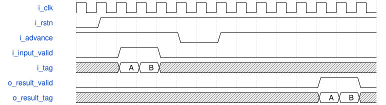

# road_round_shift 模块规范

> RTL: `road_round_shift.v`

## 1. 模块目的

Nine-stage globally enabled exact signed rounding and int16 saturation primitive, no multiplier.

## 2. 参数

| 参数 | 默认值 | 说明 |
| --- | --- | --- |
| — | — | 本模块没有可配置参数。 |

## 3. 时钟与复位

- 时钟：`{"name": "i_clk", "edge": "posedge", "frequency_hz": 100000000}`
- 复位：`{"name": "i_rstn", "active": "low", "synchronous": false, "values": "Every pipeline register and valid bit clears to zero."}`

## 4. 接口信号规范

| 信号 | 方向 | 位宽 | 时钟域 | 语义角色 | 描述 |
| --- | --- | --- | --- | --- | --- |
| `i_clk` | input | 1 | i_clk | clock | 100 MHz enclosing pipeline clock |
| `i_rstn` | input | 1 | i_clk | reset | Asynchronous active-low token cancellation |
| `i_advance` | input | 1 | i_clk | clock_enable | Enclosing pipeline enables all stages only if its held output can advance |
| `i_input_valid` | input | 1 | i_clk | input_valid | Input transfers only with advance high |
| `i_product` | input | 64 | i_clk | signed_product | Exact signed upstream product excluding INT64_MIN |
| `i_shift` | input | 6 | i_clk | shift | Right shift zero through sixty-two; sixty-three faults |
| `i_tag` | input | 16 | i_clk | tag | Opaque payload identity held with product |
| `o_result_valid` | output | 1 | i_clk | output_valid | Qualifies data, tag and fault |
| `o_result_data` | output | 16 | i_clk | result_payload | Signed saturated int16; unspecified on fault |
| `o_result_tag` | output | 16 | i_clk | output_tag | Accepted input identity |
| `o_fault` | output | 1 | i_clk | fault | Unsupported shift or minimum int64; never publish as normal result |

## 5. 周期行为与延迟

- Nine enabled edges including input acceptance produce output; latency eight enabled rising-edge intervals.
- II is one enabled clock; invalid input inserts a bubble.
- i_advance low freezes valid, fault, tag and all datapath registers; caller must deassert it if output cannot be accepted.
- Round exact absolute quotient/remainder with nearest even, restore sign and saturate to signed int16.
- Unsupported input yields a tagged fault; result data must be ignored.
- Reset cancels all tokens, including stalled output.

## 6. WaveDrom 时序图

### Enabled clocks and a common stall

Two adjacent tokens reach the output after eight enabled intervals; common stall holds them and all payloads.

- WaveJSON：[road_round_shift_stream-with-stall.json5](waveforms/road_round_shift_stream-with-stall.json5)

## 7. 边界、反压与错误

- Shift zero has no fractional increment.
- Negative half ties restore sign after even rounding.
- Positive and negative saturation never wrap.
- Shift sixty-three and INT64_MIN fault.
- Stalls extend elapsed latency by exactly their duration.

## 8. CDC 与综合约束

- Verilog-2001 only, no multiplier or DSP claim.
- Only one clock domain, common clock enable, no gated clocks.
- This primitive is not an independently elastic ready/valid stage; enclosing pipeline owns readiness.
- INT64_MIN is outside the upstream legal int32 times nonnegative int32 product range.

## 9. 验证与验收

- Exact Fraction vectors cover all sixty-three legal shifts and positive/negative half ties.
- CPU cross-checks existing integer.requantize.
- Self-checking RTL tests include continuous tokens, bubbles, common-enable stalls, tags, fault and reset cancellation.

## 10. 可追溯性

- 规格模块：`road_round_shift`
- RTL 路径：`road_round_shift.v`
- 交付要求：本文档、WaveJSON 和 SVG 必须与同一版本规格一同发布。
