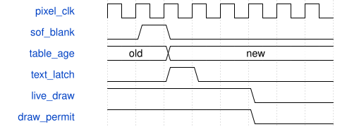

# road_age_overlay 模块规范

> RTL: `road_age_overlay.v`

## 1. 模块目的

复用固定字形的结果年龄文字

## 2. 参数

| 参数 | 默认值 | 说明 |
| --- | --- | --- |
| — | — | 本模块没有可配置参数。 |

## 3. 时钟与复位

- 时钟：`{"time_hz": 100000000, "camera_nominal_hz": 60000000, "hdmi_hz": 75000000, "camera_clock_is_measured": false, "single_absolute_counter": "frozen road_time_snapshot.o_src_now_ms", "epoch": "stable for each coordinated reset interval; never hot-switch"}`
- 复位：`{"assertion": "common asynchronous cancellation", "release": "identity two local release edges; overlay uses supplied pixel-domain released reset"}`

## 4. 接口信号规范

| 信号 | 方向 | 位宽 | 时钟域 | 语义角色 | 描述 |
| --- | --- | --- | --- | --- | --- |
| `i_clk` | input | 1 | 未声明 | i_clk | i_clk |
| `i_rstn` | input | 1 | 未声明 | i_rstn | i_rstn |
| `i_sof` | input | 1 | 未声明 | i_sof | i_sof |
| `i_vsync` | input | 1 | 未声明 | i_vsync | i_vsync |
| `i_hsync` | input | 1 | 未声明 | i_hsync | i_hsync |
| `i_de` | input | 1 | 未声明 | i_de | i_de |
| `i_rgb` | input | 24 | 未声明 | i_rgb | i_rgb |
| `i_age_upper_ms` | input | 64 | 未声明 | i_age_upper_ms | i_age_upper_ms |
| `i_table_draw_valid` | input | 1 | 未声明 | i_table_draw_valid | i_table_draw_valid |
| `o_vsync` | output | 1 | 未声明 | o_vsync | o_vsync |
| `o_hsync` | output | 1 | 未声明 | o_hsync | o_hsync |
| `o_de` | output | 1 | 未声明 | o_de | o_de |
| `o_rgb` | output | 24 | 未声明 | o_rgb | o_rgb |
| `o_draw_permit` | output | 1 | 未声明 | o_draw_permit | o_draw_permit |

## 5. 周期行为与延迟

- Reuse fixed 5x7 row-bitmaps and one-clock RGB/VS/HS/DE output register, not a general text engine.
- Eleven 12x16 cells at x16..147,y16..31: AGE xxxx ms, or AGE_INVALID. Numeric ages 0..9999 only; UINT64_MAX and larger values display INVALID, never 0.
- Latch the current table age on the first blanking edge AFTER i_sof, so a table active-bank switch on i_sof is visible. i_sof must be in blanking; first active pixel must follow that latch edge.
- Latched text/digits remain stable for the rest of the frame; o_draw_permit always equals live i_table_draw_valid AND reset, not the latched age.
- A normal empty table can still show its known age while draw permission is zero. An expired known age can be displayed, but cannot re-enable boxes.
- Existing table computes conservative snapshot-capture+4ms. New demo table instances use approved2000ms; old500ms baseline remains untouched.

## 6. WaveDrom 时序图

### 源帧接纳或帧边界年龄切换

Digital waveform only; no physical CDC signoff.

- WaveJSON：[road_age_overlay_normal.json5](waveforms/road_age_overlay_normal.json5)

## 7. 边界、反压与错误

- SOF during reset, no time, busy, no credit, long stall, common reset, unknown age

## 8. CDC 与综合约束

- Actual admission credit/slot association and full pixel DMA are NOT connected by an identity event.
- No production integration, TD, physical CDC/MTBF/bundled timing signoff, bitstream or board proof in this batch.
- The descriptor contains source identity/time only; task_id, model_id and slot metadata are owned by the application scheduler.
- No independent hot reset or real DDR late-return drain is proved.

## 9. 验证与验收

- Python reference first
- actual local ModelSim
- strict eight gates kept separate

## 10. 可追溯性

- 规格模块：`road_age_overlay`
- RTL 路径：`road_age_overlay.v`
- 交付要求：本文档、WaveJSON 和 SVG 必须与同一版本规格一同发布。
