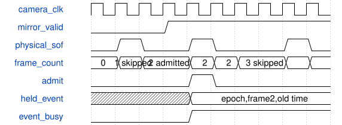

# road_source_sof_identity 模块规范

> RTL: `road_source_sof_identity.v`

## 1. 模块目的

真实AWB源帧身份与单计时器镜像

## 2. 参数

| 参数 | 默认值 | 说明 |
| --- | --- | --- |
| MIRROR_TIMEOUT_CYCLES | 120000 | 已配置摄像头域两毫秒失联计数，不是绝对计时器 |

## 3. 时钟与复位

- 时钟：`{"time_hz": 100000000, "camera_nominal_hz": 60000000, "hdmi_hz": 75000000, "camera_clock_is_measured": false, "single_absolute_counter": "frozen road_time_snapshot.o_src_now_ms", "epoch": "stable for each coordinated reset interval; never hot-switch"}`
- 复位：`{"assertion": "common asynchronous cancellation", "release": "identity two local release edges; overlay uses supplied pixel-domain released reset"}`

## 4. 接口信号规范

| 信号 | 方向 | 位宽 | 时钟域 | 语义角色 | 描述 |
| --- | --- | --- | --- | --- | --- |
| `i_time_clk` | input | 1 | 未声明 | i_time_clk | i_time_clk |
| `i_camera_clk` | input | 1 | 未声明 | i_camera_clk | i_camera_clk |
| `i_rstn` | input | 1 | 未声明 | i_rstn | i_rstn |
| `i_time_now_ms` | input | 64 | 未声明 | i_time_now_ms | i_time_now_ms |
| `i_time_tick` | input | 1 | 未声明 | i_time_tick | i_time_tick |
| `i_time_epoch` | input | 32 | 未声明 | i_time_epoch | i_time_epoch |
| `i_camera_sof` | input | 1 | 未声明 | i_camera_sof | i_camera_sof |
| `i_capture_credit` | input | 1 | 未声明 | i_capture_credit | i_capture_credit |
| `o_frame_admit` | output | 1 | 未声明 | o_frame_admit | o_frame_admit |
| `o_admit_epoch` | output | 32 | 未声明 | o_admit_epoch | o_admit_epoch |
| `o_admit_frame_id` | output | 32 | 未声明 | o_admit_frame_id | o_admit_frame_id |
| `o_admit_capture_ms` | output | 64 | 未声明 | o_admit_capture_ms | o_admit_capture_ms |
| `o_source_frame_id` | output | 32 | 未声明 | o_source_frame_id | o_source_frame_id |
| `o_mirror_ms` | output | 64 | 未声明 | o_mirror_ms | o_mirror_ms |
| `o_mirror_epoch` | output | 32 | 未声明 | o_mirror_epoch | o_mirror_epoch |
| `o_mirror_valid` | output | 1 | 未声明 | o_mirror_valid | o_mirror_valid |
| `o_event_busy` | output | 1 | 未声明 | o_event_busy | o_event_busy |
| `o_frame_skip` | output | 1 | 未声明 | o_frame_skip | o_frame_skip |
| `o_wrap_fault` | output | 1 | 未声明 | o_wrap_fault | o_wrap_fault |
| `o_desc_valid` | output | 1 | 未声明 | o_desc_valid | o_desc_valid |
| `i_desc_ready` | input | 1 | 未声明 | i_desc_ready | i_desc_ready |
| `o_desc_payload` | output | 128 | 未声明 | o_desc_payload | o_desc_payload |

## 5. 周期行为与延迟

- All rising physical AWB SOFs count, even when credit/busy/time prevents capture.
- Arm only after observing SOF low after local reset release; high during reset never creates a phantom frame.
- o_frame_admit is combinational BEFORE the actual source SOF sampling edge; valid does not gate SOF.
- At that same edge the capture owner consumes qualified admit fields and reserves a pre-existing FREE slot.
- No mirror arriving on the SOF edge is eligible until a subsequent SOF.
- No credit, stale mirror, outstanding event or frame counter wrap skips the whole frame. No pixel backpressure.
- The physical frame counter saturates on wrap and sticky fault blocks further admission until coordinated reset with a new epoch.
- Independent held96 time request/ack and held128 source event request/ack; no dynamic bus synchronizer or asynchronous FIFO.
- Source freezes each payload before toggle, holds through two-stage returned ack. Destination two-stage request plus one stable capture wait.
- Descriptor ack occurs only after i_desc_ready && o_desc_valid at 100MHz; output payload is stable while stalled.
- Mirror valid expires on the 120001st camera edge without a completed new snapshot; common reset cancels all old events.
- The source stamp is an already completed old mirror, so source lag increases age rather than decreases it.
- Continuous configured clocks imply mirror publication lag about 1ms plus CDC. On time-clock freeze watchdog is about 2ms in camera time; camera-clock stop also stops watchdog, so bounded freshness after clock loss requires common reset.

## 6. WaveDrom 时序图

### 源帧接纳或帧边界年龄切换

Digital waveform only; no physical CDC signoff.

- WaveJSON：[road_source_sof_identity_normal.json5](waveforms/road_source_sof_identity_normal.json5)

## 7. 边界、反压与错误

- SOF during reset, no time, busy, no credit, long stall, common reset, unknown age

## 8. CDC 与综合约束

- Actual admission credit/slot association and full pixel DMA are NOT connected by an identity event.
- No production integration, TD, physical CDC/MTBF/bundled timing signoff, bitstream or board proof in this batch.
- The descriptor contains source identity/time only; task_id, model_id and slot metadata are owned by the application scheduler.
- No independent hot reset or real DDR late-return drain is proved.

## 9. 验证与验收

- Python reference first
- actual local ModelSim
- strict eight gates kept separate

## 10. 可追溯性

- 规格模块：`road_source_sof_identity`
- RTL 路径：`road_source_sof_identity.v`
- 交付要求：本文档、WaveJSON 和 SVG 必须与同一版本规格一同发布。
