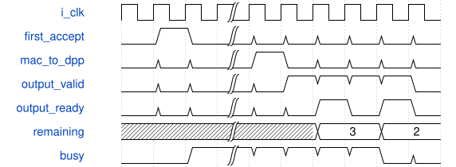

# tb_standard_arithmetic_owner 模块规范

> RTL: `tests/tb_standard_arithmetic_owner.v`

## 1. 模块目的

未提供模块目的。

## 2. 参数

| 参数 | 默认值 | 说明 |
| --- | --- | --- |
| — | — | 本模块没有可配置参数。 |

## 3. 时钟与复位

- 时钟：`{"name": "clk", "edge": "posedge", "frequency_mhz": 100}`
- 复位：`{"name": "rstn", "active": "low", "synchronous": false}`

## 4. 接口信号规范

| 信号 | 方向 | 位宽 | 时钟域 | 语义角色 | 描述 |
| --- | --- | --- | --- | --- | --- |
| `o_test_complete` | output | 1 | 未声明 | verification_completion | 全部断言完成后结束 |

## 5. 周期行为与延迟

- 单任务IDLE/GROUP/ACC/OUTPUT/FAULT三段状态机
- 首组锁存mask/tags/address/pre/post/activate，后续元数据变化忽略
- ACC只向原DPP提交一次完整MAC结果
- 最后有效lane真实输出握手后才能解除busy；故障必须共同复位
- 输出直接采用原DPP保持槽，owner没有结果array或residual

## 6. WaveDrom 时序图

### 仅最后真实输出退休释放

省略原核计算拍，输出反压保持身份，MAC交接不释放owner

- WaveJSON：[tb_standard_arithmetic_owner_retirement.json5](waveforms/tb_standard_arithmetic_owner_retirement.json5)

## 7. 边界、反压与错误

- mask1/3/7、opaque唯一tags、错误/重复身份与错误类型
- 激活输出必须INT8符号扩展；raw保留完整INT16
- 末输出背压不释放，table只在idle接受
- reset取消原核和元数据，SiLU必须重新装满

## 8. CDC 与综合约束

- 原五核端口、II、复位、算术均不改
- 所有核同域共同reset；两拍owner准入释放，最早第三沿接收
- 每路最多192乘积/24组由现固定客户端保证
- 接口无帧号；外部调度负责完整任务身份与DDR可见性

## 9. 验证与验收

- 整数参考逐MAC/pre/SiLU/post/final值
- 真实ModelSim原核和原SiLU1024表
- 多组bias一次、尾mask、首组锁存扰动
- GROUP/ACC/OUTPUT共同复位和故障保持

## 10. 可追溯性

- 规格模块：`tb_standard_arithmetic_owner`
- RTL 路径：`tests/tb_standard_arithmetic_owner.v`
- 交付要求：本文档、WaveJSON 和 SVG 必须与同一版本规格一同发布。
