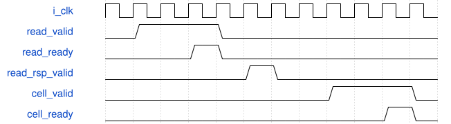

# road_head_cell_stream 模块规范

> RTL: `rtl/road_head_cell_stream.v`

## 1. 模块目的

未提供模块目的。

## 2. 参数

| 参数 | 默认值 | 说明 |
| --- | --- | --- |
| — | — | 本模块没有可配置参数。 |

## 3. 时钟与复位

- 时钟：`{"name": "i_clk", "frequency_hz": 100000000}`
- 复位：`{"name": "i_rstn", "assert": "async_low", "release": "local_sync_two_flops_or_owner_gating"}`

## 4. 接口信号规范

| 信号 | 方向 | 位宽 | 时钟域 | 语义角色 | 描述 |
| --- | --- | --- | --- | --- | --- |
| `i_clk` | input | 1 | i_clk | clk | 统一100MHz上升沿时钟 |
| `i_rstn` | input | 1 | i_clk | rstn | 共同低有效异步复位，本地两级同步释放 |
| `i_cancel` | input | 1 | i_clk | cancel | 取消当前查表，已接受的ROM读必须排空后再接新任务 |
| `i_start_valid` | input | 1 | i_clk | start_valid | start_valid：按requirements中对应事务/计数合同使用 |
| `i_start_frame_token` | input | 32 | i_clk | start_frame_token | start_frame_token：按requirements中对应事务/计数合同使用 |
| `i_start_model_id` | input | 32 | i_clk | start_model_id | start_model_id：按requirements中对应事务/计数合同使用 |
| `i_predictions_committed` | input | 1 | i_clk | predictions_committed | predictions_committed：按requirements中对应事务/计数合同使用 |
| `i_read_ready` | input | 1 | i_clk | read_ready | read_ready：按requirements中对应事务/计数合同使用 |
| `i_read_rsp_valid` | input | 1 | i_clk | read_rsp_valid | 完整DECODED160记录有效并保持至消费 |
| `i_read_rsp_address` | input | 32 | i_clk | read_rsp_address | read_rsp_address：按requirements中对应事务/计数合同使用 |
| `i_read_rsp_data` | input | 128 | i_clk | read_rsp_data | PIF1固定DECODED160记录 |
| `i_read_error` | input | 1 | i_clk | read_error | read_error：按requirements中对应事务/计数合同使用 |
| `i_cell_ready` | input | 1 | i_clk | cell_ready | cell_ready：按requirements中对应事务/计数合同使用 |
| `o_start_ready` | output | 1 | i_clk | start_ready | start_ready：按requirements中对应事务/计数合同使用 |
| `o_busy` | output | 1 | i_clk | busy | busy：按requirements中对应事务/计数合同使用 |
| `o_done` | output | 1 | i_clk | done | done：按requirements中对应事务/计数合同使用 |
| `o_fault` | output | 1 | i_clk | fault | 本组件故障状态，不得发布为成功表 |
| `o_read_valid` | output | 1 | i_clk | read_valid | read_valid：按requirements中对应事务/计数合同使用 |
| `o_read_address` | output | 32 | i_clk | read_address | read_address：按requirements中对应事务/计数合同使用 |
| `o_read_rsp_ready` | output | 1 | i_clk | read_rsp_ready | NMS消费完整候选响应 |
| `o_cell_valid` | output | 1 | i_clk | cell_valid | cell_valid：按requirements中对应事务/计数合同使用 |
| `o_cell_data` | output | 112 | i_clk | cell_data | cell_data：按requirements中对应事务/计数合同使用 |
| `o_cell_id` | output | 14 | i_clk | cell_id | cell_id：按requirements中对应事务/计数合同使用 |
| `o_cell_frame_token` | output | 32 | i_clk | cell_frame_token | cell_frame_token：按requirements中对应事务/计数合同使用 |
| `o_cell_model_id` | output | 32 | i_clk | cell_model_id | cell_model_id：按requirements中对应事务/计数合同使用 |

## 5. 周期行为与延迟

- 仅全部预测写可见且start握手才锁定token/model，依次读取六个固定INT16张量。
- 一未决128位读，全地址核验后才填行寄存器；每字段均偶数地址，不跨16字节行。
- 一个112位cell寄存器，字段0..4回归、5..6分类，12096个cell按S4/S8/S16和逐行序发布。
- cell背压保持完整数据/编号/上下文；最后cell实际消费后done；故障与cancel保留owner到共同reset。

## 6. WaveDrom 时序图

### 请求所有权与停顿

协议示意：省略内部变长计算，用空白间隔表示；不是固定总时延。仅valid与ready同拍消费。

- WaveJSON：[road_head_cell_stream_request-hold-response.json5](waveforms/road_head_cell_stream_request-hold-response.json5)

## 7. 边界、反压与错误

- 复位、取消、背压、非法身份和边界地址；取消不能当成无标签外设已排空

## 8. CDC 与综合约束

- Verilog-2001；一个未决事务；ready/valid握手；无TD/物理时序签核
- 不改变冻结算术核/数值，不复制公共存储

## 9. 验证与验收

- all12096 cells/84672 fields and exact source byte addresses
- head scale and row/tile boundaries
- H18 tail rows
- random read and cell backpressure
- request/response reset and cancellation owner
- wrong address/error
- no full prediction RAM

## 10. 可追溯性

- 规格模块：`road_head_cell_stream`
- RTL 路径：`rtl/road_head_cell_stream.v`
- 交付要求：本文档、WaveJSON 和 SVG 必须与同一版本规格一同发布。
