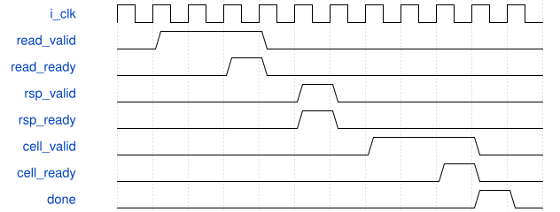

# tb_head_cell_stream 模块规范

> RTL: `tb_head_cell_stream.v`

## 1. 模块目的

未提供模块目的。

## 2. 参数

| 参数 | 默认值 | 说明 |
| --- | --- | --- |
| — | — | 本模块没有可配置参数。 |

## 3. 时钟与复位

- 时钟：`{"name": "i_clk", "edge": "posedge", "frequency_mhz": 100}`
- 复位：`{"name": "i_rstn", "active": "low", "synchronous": false}`

## 4. 接口信号规范

| 信号 | 方向 | 位宽 | 时钟域 | 语义角色 | 描述 |
| --- | --- | --- | --- | --- | --- |
| `o_test_complete` | output | 1 | 未声明 | verification_completion | 当前独立案例的实际比较通过后才置位 |

## 5. 周期行为与延迟

- 读取冻结六平面物理128位行镜像，不用expected cell驱动源响应
- 实际请求逐个对齐独立字段地址，缓存复制每字段也逐个核对原graph地址
- 实际12096输出cell完整112位/id/token/model对拍，保留随机长反压
- 末源读消费、最末cell消费和done分别记录，取消与错误持busy直到共同reset

## 6. WaveDrom 时序图

### 最后读响应与最后cell分别退休

协议示意不规定内部时延；读响应先消费，cell可以长时间保持；最后cell消费后才done。

- WaveJSON：[tb_head_cell_stream_read-cell-retirement.json5](waveforms/tb_head_cell_stream_read-cell-retirement.json5)

## 7. 边界、反压与错误

- 未committed不得准入、首握手后身份扰动、S4/S8/S16边界、H18末两行
- 请求pending、取消造成response-held、cell-held共同reset
- 错响应地址/error、取消持owner、真实checker一位负例

## 8. CDC 与综合约束

- 数组仅属于行为读服务和独立golden，不是DUT预测RAM或实际DDR
- 不更改DUT、冻结golden、五核，不做综合或物理映射

## 9. 验证与验收

- full12096_random
- uncommitted
- identity
- cancel_request
- reset_request
- reset_response_held
- reset_cell_held
- wrong_address
- read_error
- cancel_cell
- checker_negative

## 10. 可追溯性

- 规格模块：`tb_head_cell_stream`
- RTL 路径：`tb_head_cell_stream.v`
- 交付要求：本文档、WaveJSON 和 SVG 必须与同一版本规格一同发布。
