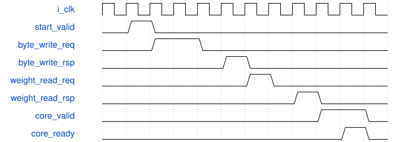

# road_standard_tile_client 模块规范

> RTL: `rtl/road_standard_tile_client.v`

## 1. 模块目的

未提供模块目的。

## 2. 参数

| 参数 | 默认值 | 说明 |
| --- | --- | --- |
| — | — | 本模块没有可配置参数。 |

## 3. 时钟与复位

- 时钟：`{"name": "i_clk", "frequency_hz": 100000000}`
- 复位：`{"name": "i_rstn", "assert": "async_low", "release": "local_sync_two_flops_or_owner_gating"}`

## 4. 接口信号规范

| 信号 | 方向 | 位宽 | 时钟域 | 语义角色 | 描述 |
| --- | --- | --- | --- | --- | --- |
| `i_clk` | input | 1 | i_clk | clk | 统一100MHz上升沿时钟 |
| `i_rstn` | input | 1 | i_clk | rstn | 共同低有效异步复位，本地两级同步释放 |
| `i_cancel` | input | 1 | i_clk | cancel | 取消当前查表，已接受的ROM读必须排空后再接新任务 |
| `i_start_valid` | input | 1 | i_clk | start_valid | start_valid：按requirements中对应事务/计数合同使用 |
| `i_layer_id` | input | 7 | i_clk | layer_id | layer_id：按requirements中对应事务/计数合同使用 |
| `i_tile_y` | input | 6 | i_clk | tile_y | tile_y：按requirements中对应事务/计数合同使用 |
| `i_tile_x` | input | 7 | i_clk | tile_x | tile_x：按requirements中对应事务/计数合同使用 |
| `i_table_loaded` | input | 1 | i_clk | table_loaded | table_loaded：按requirements中对应事务/计数合同使用 |
| `i_parameter_ready` | input | 1 | i_clk | parameter_ready | parameter_ready：按requirements中对应事务/计数合同使用 |
| `i_parameter_rsp_valid` | input | 1 | i_clk | parameter_rsp_valid | parameter_rsp_valid：按requirements中对应事务/计数合同使用 |
| `i_parameter_rsp_layer` | input | 7 | i_clk | parameter_rsp_layer | parameter_rsp_layer：按requirements中对应事务/计数合同使用 |
| `i_parameter_rsp_channel` | input | 7 | i_clk | parameter_rsp_channel | parameter_rsp_channel：按requirements中对应事务/计数合同使用 |
| `i_parameter_rsp_window` | input | 3 | i_clk | parameter_rsp_window | parameter_rsp_window：按requirements中对应事务/计数合同使用 |
| `i_parameter_rsp_group` | input | 5 | i_clk | parameter_rsp_group | parameter_rsp_group：按requirements中对应事务/计数合同使用 |
| `i_parameter_weight` | input | 192 | i_clk | parameter_weight | parameter_weight：按requirements中对应事务/计数合同使用 |
| `i_parameter_quant` | input | 248 | i_clk | parameter_quant | parameter_quant：按requirements中对应事务/计数合同使用 |
| `i_parameter_error` | input | 1 | i_clk | parameter_error | parameter_error：按requirements中对应事务/计数合同使用 |
| `i_read_ready` | input | 1 | i_clk | read_ready | read_ready：按requirements中对应事务/计数合同使用 |
| `i_read_rsp_valid` | input | 1 | i_clk | read_rsp_valid | 完整DECODED160记录有效并保持至消费 |
| `i_read_rsp_address` | input | 32 | i_clk | read_rsp_address | read_rsp_address：按requirements中对应事务/计数合同使用 |
| `i_read_rsp_data` | input | 128 | i_clk | read_rsp_data | PIF1固定DECODED160记录 |
| `i_read_error` | input | 1 | i_clk | read_error | read_error：按requirements中对应事务/计数合同使用 |
| `i_write_ready` | input | 1 | i_clk | write_ready | write_ready：按requirements中对应事务/计数合同使用 |
| `i_barrier_ready` | input | 1 | i_clk | barrier_ready | barrier_ready：按requirements中对应事务/计数合同使用 |
| `i_barrier_layer` | input | 7 | i_clk | barrier_layer | barrier_layer：按requirements中对应事务/计数合同使用 |
| `i_barrier_tile_y` | input | 6 | i_clk | barrier_tile_y | barrier_tile_y：按requirements中对应事务/计数合同使用 |
| `i_barrier_tile_x` | input | 7 | i_clk | barrier_tile_x | barrier_tile_x：按requirements中对应事务/计数合同使用 |
| `i_byte_req_ready` | input | 1 | i_clk | byte_req_ready | byte_req_ready：按requirements中对应事务/计数合同使用 |
| `i_byte_rsp_valid` | input | 1 | i_clk | byte_rsp_valid | byte_rsp_valid：按requirements中对应事务/计数合同使用 |
| `i_byte_rsp_data` | input | 8 | i_clk | byte_rsp_data | byte_rsp_data：按requirements中对应事务/计数合同使用 |
| `i_byte_rsp_error` | input | 1 | i_clk | byte_rsp_error | byte_rsp_error：按requirements中对应事务/计数合同使用 |
| `i_weight_req_ready` | input | 1 | i_clk | weight_req_ready | weight_req_ready：按requirements中对应事务/计数合同使用 |
| `i_weight_rsp_valid` | input | 1 | i_clk | weight_rsp_valid | weight_rsp_valid：按requirements中对应事务/计数合同使用 |
| `i_weight_rsp_data` | input | 192 | i_clk | weight_rsp_data | weight_rsp_data：按requirements中对应事务/计数合同使用 |
| `i_weight_rsp_error` | input | 1 | i_clk | weight_rsp_error | weight_rsp_error：按requirements中对应事务/计数合同使用 |
| `i_work_fault` | input | 1 | i_clk | work_fault | work_fault：按requirements中对应事务/计数合同使用 |
| `i_core_ready` | input | 1 | i_clk | core_ready | core_ready：按requirements中对应事务/计数合同使用 |
| `i_core_output_valid` | input | 1 | i_clk | core_output_valid | core_output_valid：按requirements中对应事务/计数合同使用 |
| `i_core_output_tag` | input | 16 | i_clk | core_output_tag | core_output_tag：按requirements中对应事务/计数合同使用 |
| `i_core_output_address` | input | 32 | i_clk | core_output_address | core_output_address：按requirements中对应事务/计数合同使用 |
| `i_core_output_data` | input | 8 | i_clk | core_output_data | core_output_data：按requirements中对应事务/计数合同使用 |
| `i_core_fault` | input | 1 | i_clk | core_fault | core_fault：按requirements中对应事务/计数合同使用 |
| `o_start_ready` | output | 1 | i_clk | start_ready | start_ready：按requirements中对应事务/计数合同使用 |
| `o_busy` | output | 1 | i_clk | busy | busy：按requirements中对应事务/计数合同使用 |
| `o_done` | output | 1 | i_clk | done | done：按requirements中对应事务/计数合同使用 |
| `o_fault` | output | 1 | i_clk | fault | 本组件故障状态，不得发布为成功表 |
| `o_layer_id` | output | 7 | i_clk | layer_id | layer_id：按requirements中对应事务/计数合同使用 |
| `o_tile_y` | output | 6 | i_clk | tile_y | tile_y：按requirements中对应事务/计数合同使用 |
| `o_tile_x` | output | 7 | i_clk | tile_x | tile_x：按requirements中对应事务/计数合同使用 |
| `o_parameter_valid` | output | 1 | i_clk | parameter_valid | parameter_valid：按requirements中对应事务/计数合同使用 |
| `o_parameter_channel` | output | 7 | i_clk | parameter_channel | parameter_channel：按requirements中对应事务/计数合同使用 |
| `o_parameter_window` | output | 3 | i_clk | parameter_window | parameter_window：按requirements中对应事务/计数合同使用 |
| `o_parameter_group` | output | 5 | i_clk | parameter_group | parameter_group：按requirements中对应事务/计数合同使用 |
| `o_parameter_rsp_ready` | output | 1 | i_clk | parameter_rsp_ready | parameter_rsp_ready：按requirements中对应事务/计数合同使用 |
| `o_read_valid` | output | 1 | i_clk | read_valid | read_valid：按requirements中对应事务/计数合同使用 |
| `o_read_address` | output | 32 | i_clk | read_address | read_address：按requirements中对应事务/计数合同使用 |
| `o_read_rsp_ready` | output | 1 | i_clk | read_rsp_ready | NMS消费完整候选响应 |
| `o_write_valid` | output | 1 | i_clk | write_valid | write_valid：按requirements中对应事务/计数合同使用 |
| `o_write_address` | output | 32 | i_clk | write_address | write_address：按requirements中对应事务/计数合同使用 |
| `o_write_data` | output | 8 | i_clk | write_data | write_data：按requirements中对应事务/计数合同使用 |
| `o_barrier_valid` | output | 1 | i_clk | barrier_valid | barrier_valid：按requirements中对应事务/计数合同使用 |
| `o_byte_req_valid` | output | 1 | i_clk | byte_req_valid | byte_req_valid：按requirements中对应事务/计数合同使用 |
| `o_byte_req_write` | output | 1 | i_clk | byte_req_write | byte_req_write：按requirements中对应事务/计数合同使用 |
| `o_byte_req_addr` | output | 12 | i_clk | byte_req_addr | byte_req_addr：按requirements中对应事务/计数合同使用 |
| `o_byte_req_data` | output | 8 | i_clk | byte_req_data | byte_req_data：按requirements中对应事务/计数合同使用 |
| `o_byte_rsp_ready` | output | 1 | i_clk | byte_rsp_ready | byte_rsp_ready：按requirements中对应事务/计数合同使用 |
| `o_weight_req_valid` | output | 1 | i_clk | weight_req_valid | weight_req_valid：按requirements中对应事务/计数合同使用 |
| `o_weight_req_write` | output | 1 | i_clk | weight_req_write | weight_req_write：按requirements中对应事务/计数合同使用 |
| `o_weight_req_group` | output | 5 | i_clk | weight_req_group | weight_req_group：按requirements中对应事务/计数合同使用 |
| `o_weight_req_data` | output | 192 | i_clk | weight_req_data | weight_req_data：按requirements中对应事务/计数合同使用 |
| `o_weight_rsp_ready` | output | 1 | i_clk | weight_rsp_ready | weight_rsp_ready：按requirements中对应事务/计数合同使用 |
| `o_core_valid` | output | 1 | i_clk | core_valid | core_valid：按requirements中对应事务/计数合同使用 |
| `o_core_first` | output | 1 | i_clk | core_first | core_first：按requirements中对应事务/计数合同使用 |
| `o_core_last` | output | 1 | i_clk | core_last | core_last：按requirements中对应事务/计数合同使用 |
| `o_core_input_mask` | output | 8 | i_clk | core_input_mask | core_input_mask：按requirements中对应事务/计数合同使用 |
| `o_core_activation` | output | 64 | i_clk | core_activation | core_activation：按requirements中对应事务/计数合同使用 |
| `o_core_weight` | output | 192 | i_clk | core_weight | core_weight：按requirements中对应事务/计数合同使用 |
| `o_core_bias` | output | 96 | i_clk | core_bias | core_bias：按requirements中对应事务/计数合同使用 |
| `o_core_output_mask` | output | 3 | i_clk | core_output_mask | core_output_mask：按requirements中对应事务/计数合同使用 |
| `o_core_tags` | output | 48 | i_clk | core_tags | core_tags：按requirements中对应事务/计数合同使用 |
| `o_core_addresses` | output | 96 | i_clk | core_addresses | core_addresses：按requirements中对应事务/计数合同使用 |
| `o_core_pre_multiplier` | output | 96 | i_clk | core_pre_multiplier | core_pre_multiplier：按requirements中对应事务/计数合同使用 |
| `o_core_pre_shift` | output | 18 | i_clk | core_pre_shift | core_pre_shift：按requirements中对应事务/计数合同使用 |
| `o_core_post_multiplier` | output | 32 | i_clk | core_post_multiplier | core_post_multiplier：按requirements中对应事务/计数合同使用 |
| `o_core_post_shift` | output | 6 | i_clk | core_post_shift | core_post_shift：按requirements中对应事务/计数合同使用 |
| `o_core_output_ready` | output | 1 | i_clk | core_output_ready | core_output_ready：按requirements中对应事务/计数合同使用 |

## 5. 周期行为与延迟

- 锁存固定graph层与对齐tile；一任务覆盖真实有效行和全部输出通道，不冒充整层。
- 先完整覆盖WIF1 byte/weight使用范围，所有写响应退休后再读。DW逐通道81B，PW16*Cin。
- 每组先同步读weight响应，再逐byte组装activation；发射保持至核ready；偏置仅first有效。
- 输出逐tag核验mask、地址与唯一性；全部真实写接受后再发barrier；barrier身份核验后done。
- cancel/fault占有直到共同reset；不允许借此切owner或宣称DDR已排空。

## 6. WaveDrom 时序图

### 请求所有权与停顿

协议示意：省略内部变长计算，用空白间隔表示；不是固定总时延。仅valid与ready同拍消费。

- WaveJSON：[road_standard_tile_client_request-hold-response.json5](waveforms/road_standard_tile_client_request-hold-response.json5)

## 7. 边界、反压与错误

- 复位、取消、背压、非法身份和边界地址；取消不能当成无标签外设已排空

## 8. CDC 与综合约束

- Verilog-2001；一个未决事务；ready/valid握手；无TD/物理时序签核
- 不改变冻结算术核/数值，不复制公共存储
- C4独占工作仓实现；本客户无私有tile/weight数组
- 首批仅INT8四层，不含INT16预测头或物理时序

## 9. 验证与验收

- four layers real G10 parameter representative corner/interior tiles
- H18 tail row protection
- intermediate acc/pre/SiLU/post
- random source/parameter/WIF/core/write backpressure
- common reset outstanding read/write
- bad parameter identity and illegal tile/layer
- no private caches and stable stalled payloads

## 10. 可追溯性

- 规格模块：`road_standard_tile_client`
- RTL 路径：`rtl/road_standard_tile_client.v`
- 交付要求：本文档、WaveJSON 和 SVG 必须与同一版本规格一同发布。
