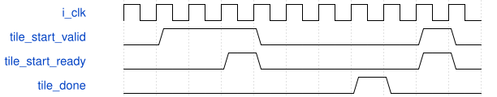

# road_standard_layer_sequence 模块规范

> RTL: `rtl/road_standard_layer_sequence.v`

## 1. 模块目的

未提供模块目的。

## 2. 参数

| 参数 | 默认值 | 说明 |
| --- | --- | --- |
| — | — | 本模块没有可配置参数。 |

## 3. 时钟与复位

- 时钟：`{"name": "i_clk", "frequency_hz": 100000000}`
- 复位：`{"name": "i_rstn", "assert": "async_low", "release": "local_sync_two_flops_or_owner_gating"}`

## 4. 接口信号规范

| 信号 | 方向 | 位宽 | 时钟域 | 语义角色 | 描述 |
| --- | --- | --- | --- | --- | --- |
| `i_clk` | input | 1 | i_clk | clk | 统一100MHz上升沿时钟 |
| `i_rstn` | input | 1 | i_clk | rstn | 共同低有效异步复位，本地两级同步释放 |
| `i_cancel` | input | 1 | i_clk | cancel | 取消当前查表，已接受的ROM读必须排空后再接新任务 |
| `i_start_valid` | input | 1 | i_clk | start_valid | start_valid：按requirements中对应事务/计数合同使用 |
| `i_layer_id` | input | 7 | i_clk | layer_id | layer_id：按requirements中对应事务/计数合同使用 |
| `i_tile_start_ready` | input | 1 | i_clk | tile_start_ready | tile_start_ready：按requirements中对应事务/计数合同使用 |
| `i_tile_done` | input | 1 | i_clk | tile_done | tile_done：按requirements中对应事务/计数合同使用 |
| `i_tile_fault` | input | 1 | i_clk | tile_fault | tile_fault：按requirements中对应事务/计数合同使用 |
| `o_start_ready` | output | 1 | i_clk | start_ready | start_ready：按requirements中对应事务/计数合同使用 |
| `o_busy` | output | 1 | i_clk | busy | busy：按requirements中对应事务/计数合同使用 |
| `o_done` | output | 1 | i_clk | done | done：按requirements中对应事务/计数合同使用 |
| `o_fault` | output | 1 | i_clk | fault | 本组件故障状态，不得发布为成功表 |
| `o_tile_start_valid` | output | 1 | i_clk | tile_start_valid | tile_start_valid：按requirements中对应事务/计数合同使用 |
| `o_layer_id` | output | 7 | i_clk | layer_id | layer_id：按requirements中对应事务/计数合同使用 |
| `o_tile_y` | output | 7 | i_clk | tile_y | tile_y：按requirements中对应事务/计数合同使用 |
| `o_tile_x` | output | 7 | i_clk | tile_x | tile_x：按requirements中对应事务/计数合同使用 |

## 5. 周期行为与延迟

- start握手锁存31个固定节点之一；形状case来自冻结graph，不接受任意外部H/W。
- 逐tile发起并等待真实客户端done；客户端done契约要求全部未决消费且写屏障通过。
- x先增4，行尾y增4；最后tile done后整层done；受控端点只证明调度，不是整层计算。
- 故障/cancel保持owner至共同reset，不以固定等待替代退休。

## 6. WaveDrom 时序图

### 请求所有权与停顿

协议示意：省略内部变长计算，用空白间隔表示；不是固定总时延。仅valid与ready同拍消费。

- WaveJSON：[road_standard_layer_sequence_request-hold-response.json5](waveforms/road_standard_layer_sequence_request-hold-response.json5)

## 7. 边界、反压与错误

- 复位、取消、背压、非法身份和边界地址；取消不能当成无标签外设已排空

## 8. CDC 与综合约束

- Verilog-2001；一个未决事务；ready/valid握手；无TD/物理时序签核
- 不改变冻结算术核/数值，不复制公共存储

## 9. 验证与验收

- 11数值向量、protocol、phase_reset，逐项DECODED160对拍

## 10. 可追溯性

- 规格模块：`road_standard_layer_sequence`
- RTL 路径：`rtl/road_standard_layer_sequence.v`
- 交付要求：本文档、WaveJSON 和 SVG 必须与同一版本规格一同发布。
