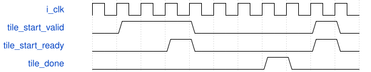

# tb_standard_layer_sequence 模块规范

> RTL: `tb_standard_layer_sequence.v`

## 1. 模块目的

未提供模块目的。

## 2. 参数

| 参数 | 默认值 | 说明 |
| --- | --- | --- |
| — | — | 本模块没有可配置参数。 |

## 3. 时钟与复位

- 时钟：`{"name": "i_clk", "frequency_hz": 100000000}`
- 复位：`{"name": "i_rstn", "assert": "async_low", "release": "local_sync_two_flops_or_owner_gating"}`

## 4. 接口信号规范

| 信号 | 方向 | 位宽 | 时钟域 | 语义角色 | 描述 |
| --- | --- | --- | --- | --- | --- |
| `o_test_complete` | output | 1 | i_clk | test_complete | 全部调度/取消复位断言通过才置高，非生产端口 |

## 5. 周期行为与延迟

- 独立内部100MHz时钟与共同reset激励。
- 6240条Python固定指令逐次比层/行/列，随机请求背压和完成延迟，31层末tile才done。
- 非法层拒绝、取消不释放owner、共同reset恢复；受控tile端点不执行任何卷积或真实DDR。

## 6. WaveDrom 时序图

### 请求所有权与停顿

协议示意：省略内部变长计算，用空白间隔表示；不是固定总时延。仅valid与ready同拍消费。

- WaveJSON：[tb_standard_layer_sequence_request-hold-response.json5](waveforms/tb_standard_layer_sequence_request-hold-response.json5)

## 7. 边界、反压与错误

- 复位、取消、背压、非法身份和边界地址；取消不能当成无标签外设已排空

## 8. CDC 与综合约束

- 仅Verilog testbench，不可综合，不代表物理实现或完整数值层计算

## 9. 验证与验收

- 11数值向量、protocol、phase_reset，逐项DECODED160对拍

## 10. 可追溯性

- 规格模块：`tb_standard_layer_sequence`
- RTL 路径：`tb_standard_layer_sequence.v`
- 交付要求：本文档、WaveJSON 和 SVG 必须与同一版本规格一同发布。
