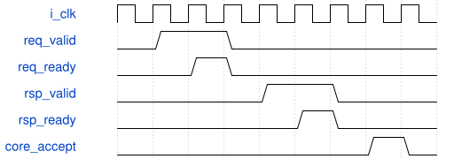

# tb_standard_tile_client 模块规范

> RTL: `tb_standard_tile_client.v`

## 1. 模块目的

未提供模块目的。

## 2. 参数

| 参数 | 默认值 | 说明 |
| --- | --- | --- |
| — | — | 本模块没有可配置参数。 |

## 3. 时钟与复位

- 时钟：`{"name": "i_clk", "edge": "posedge", "frequency_mhz": 100}`
- 复位：`{"name": "i_rstn", "active": "low", "synchronous": false}`

## 4. 接口信号规范

| 信号 | 方向 | 位宽 | 时钟域 | 语义角色 | 描述 |
| --- | --- | --- | --- | --- | --- |
| `o_test_complete` | output | 1 | 未声明 | verification_completion | 全部真实自检通过后置位 |

## 5. 周期行为与延迟

- 实例化唯一冻结24MAC和动态pre/SiLU/post owner，外部WIF1为明确行为端点
- 每通道最多一个未退休事务，随机请求ready与响应延迟，实际握手才推进
- 逐个WIF请求轨迹、signed33部分和、最终acc/pre/SiLU/post以及输出字节地址核验

## 6. WaveDrom 时序图

### WIF1请求接受与响应消费分开

请求和响应各自保持至握手，组发射前响应已消费；示意不规定native延迟

- WaveJSON：[tb_standard_tile_client_wif-retirement.json5](waveforms/tb_standard_tile_client_wif-retirement.json5)

## 7. 边界、反压与错误

- 四角/内部、H18底部两有效行、mask1尾输出
- 非法layer/tile、错误参数身份、取消占有、共同reset未退休请求/响应

## 8. CDC 与综合约束

- 数组只在testbench用于行为存储，不代表物理4ERAM
- CPU来源仅证明本层代表tile，未证明实际完整前缀、DDR或整网
- 冻结五核接口、II、复位及数值不修改

## 9. 验证与验收

- 20真实G10参数tile全数值比对
- 随机反压载荷保持
- 实际acc检查器注入1bit负例必须失败
- 窄协议故障只由共同reset解除

## 10. 可追溯性

- 规格模块：`tb_standard_tile_client`
- RTL 路径：`tb_standard_tile_client.v`
- 交付要求：本文档、WaveJSON 和 SVG 必须与同一版本规格一同发布。
