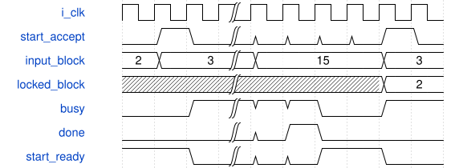
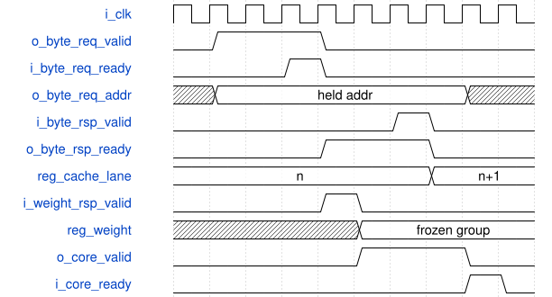

# road_feature_blocks_client 模块规范

> RTL: `rtl/road_feature_blocks_client.v`

## 1. 模块目的

未提供模块目的。

## 2. 参数

| 参数 | 默认值 | 说明 |
| --- | --- | --- |
| — | — | 本模块没有可配置参数。 |

## 3. 时钟与复位

- 时钟：`{"name": "i_clk", "edge": "posedge", "frequency_mhz": 100}`
- 复位：`{"name": "i_rstn", "active": "low", "synchronous": false}`

## 4. 接口信号规范

| 信号 | 方向 | 位宽 | 时钟域 | 语义角色 | 描述 |
| --- | --- | --- | --- | --- | --- |
| `i_clk` | input | 1 | 未声明 | native | 与算术owner同域100MHz |
| `i_rstn` | input | 1 | 未声明 | native | 共同异步复位，服务同时撤销旧响应 |
| `i_block_id` | input | 4 | 未声明 | native | 仅start握手锁存的固定块编号 |
| `o_block_id` | output | 4 | 未声明 | native | 当前任务身份直到下一次start保持 |
| `i_start` | input | 1 | 未声明 | native | ready时启动一次完整固定图任务 |
| `i_cancel` | input | 1 | 未声明 | native | 取消后故障占有至共同复位 |
| `i_table_loaded` | input | 1 | 未声明 | native | 外部owner已装入同包SiLU表 |
| `o_start_ready` | output | 1 | 未声明 | native | 空闲、无故障且表有效 |
| `o_busy` | output | 1 | 未声明 | native | 包含完成拍和故障占有 |
| `o_done` | output | 1 | 未声明 | native | 末阶段可见性确认后单拍完成 |
| `o_fault` | output | 1 | 未声明 | native | 信任边界错误粘滞指示 |
| `o_layer` | output | 3 | 未声明 | native | 当前块内阶段编号 |
| `o_tile_y` | output | 7 | 未声明 | native | 当前四行块起点诊断 |
| `o_tile_x` | output | 8 | 未声明 | native | 当前四列块起点诊断 |
| `o_parameter_valid` | output | 1 | 未声明 | native | 当前参数分片请求有效 |
| `o_parameter_channel` | output | 7 | 未声明 | native | DW通道或PW输出三通道起点 |
| `o_parameter_group` | output | 5 | 未声明 | native | 八输入归约组编号 |
| `o_parameter_window` | output | 3 | 未声明 | native | DW窗口并集宽度，PW为零 |
| `i_parameter_ready` | input | 1 | 未声明 | native | 参数请求被服务接受 |
| `i_parameter_response_valid` | input | 1 | 未声明 | native | 参数响应保持至ready |
| `o_parameter_response_ready` | output | 1 | 未声明 | native | 只消费当前未完成请求 |
| `i_parameter_response_block_id` | input | 4 | 未声明 | native | 响应必须属于当前锁存块 |
| `i_parameter_response_layer` | input | 3 | 未声明 | native | 参数响应阶段身份 |
| `i_parameter_response_channel` | input | 7 | 未声明 | native | 参数响应输出通道身份 |
| `i_parameter_response_group` | input | 5 | 未声明 | native | 参数响应归约组身份 |
| `i_parameter_response_window` | input | 3 | 未声明 | native | 参数响应DW窗口形态 |
| `i_parameter_weight` | input | 192 | 未声明 | native | 三路八输入权重 |
| `i_parameter_data` | input | 248 | 未声明 | native | bias及动态量化字段 |
| `i_parameter_error` | input | 1 | 未声明 | native | 参数服务显式错误 |
| `o_read_valid` | output | 1 | 未声明 | native | 单个16字节行请求有效 |
| `o_read_address` | output | 32 | 未声明 | native | 十六字节对齐逻辑地址 |
| `i_read_ready` | input | 1 | 未声明 | native | 行请求被内存服务接受 |
| `i_read_response_valid` | input | 1 | 未声明 | native | 行响应保持至ready |
| `o_read_response_ready` | output | 1 | 未声明 | native | 只消费当前未完成行请求 |
| `i_read_response_address` | input | 32 | 未声明 | native | 必须匹配请求的对齐地址 |
| `i_read_response_data` | input | 128 | 未声明 | native | 低字节对应地址偏移零 |
| `i_read_error` | input | 1 | 未声明 | native | 内存服务显式读错误 |
| `o_write_valid` | output | 1 | 未声明 | native | 合法核结果写请求 |
| `o_write_address` | output | 32 | 未声明 | native | 完整冻结图字节地址 |
| `o_write_data` | output | 8 | 未声明 | native | 最终饱和INT8结果 |
| `o_write_sum` | output | 9 | 未声明 | native | 饱和前signed9残差和 |
| `i_write_ready` | input | 1 | 未声明 | native | 外部写服务接受 |
| `o_barrier_valid` | output | 1 | 未声明 | native | 当前整层全部写接受后的屏障 |
| `i_barrier_ready` | input | 1 | 未声明 | native | 此层此前写已经可读 |
| `i_barrier_block_id` | input | 4 | 未声明 | native | 屏障必须属于当前锁存块 |
| `i_barrier_layer` | input | 3 | 未声明 | native | 屏障确认所属阶段 |
| `o_core_valid` | output | 1 | 未声明 | native | 原算术核输入组有效 |
| `i_core_ready` | input | 1 | 未声明 | native | 原算术核输入组接受 |
| `o_core_first` | output | 1 | 未声明 | native | 当前任务首归约组 |
| `o_core_last` | output | 1 | 未声明 | native | 当前任务末归约组 |
| `o_core_input_mask` | output | 8 | 未声明 | native | 当前八输入有效掩码 |
| `o_core_activation` | output | 64 | 未声明 | native | 串行拼装的八个INT8输入 |
| `o_core_weight` | output | 192 | 未声明 | native | 当前归约组驻留参数 |
| `o_core_bias` | output | 96 | 未声明 | native | 三路首组偏置 |
| `o_core_output_mask` | output | 3 | 未声明 | native | DW行尾任务只启用lane零 |
| `o_core_tags` | output | 48 | 未声明 | native | 固定三路任务身份 |
| `o_core_addresses` | output | 96 | 未声明 | native | 三路完整写地址 |
| `o_core_pre_multiplier` | output | 96 | 未声明 | native | 三路动态前乘数 |
| `o_core_pre_shift` | output | 18 | 未声明 | native | 三路六位前移位 |
| `o_core_post_multiplier` | output | 32 | 未声明 | native | 当前层共享后乘数 |
| `o_core_post_shift` | output | 6 | 未声明 | native | 当前层共享后移位 |
| `o_core_residual` | output | 1 | 未声明 | native | PW残差阶段使能 |
| `o_core_bypass` | output | 24 | 未声明 | native | 三路真实旁路值 |
| `i_core_output_valid` | input | 1 | 未声明 | native | 原五级写回结果有效 |
| `o_core_output_ready` | output | 1 | 未声明 | native | 核结果和外部写原子接受 |
| `i_core_output_tag` | input | 16 | 未声明 | native | 原核返回任务lane |
| `i_core_output_address` | input | 32 | 未声明 | native | 原核返回完整地址 |
| `i_core_output_data` | input | 8 | 未声明 | native | 原核返回sat8数据 |
| `i_core_output_sum` | input | 9 | 未声明 | native | 原核返回signed9和 |
| `i_core_fault` | input | 1 | 未声明 | native | 原核错误保持原语义 |
| `o_byte_req_valid` | output | 1 | 未声明 | native | 工作byte请求保持至接受 |
| `i_byte_req_ready` | input | 1 | 未声明 | native | 工作byte请求实际接纳 |
| `o_byte_req_write` | output | 1 | 未声明 | native | 预取写入或操作数读出选择 |
| `o_byte_req_addr` | output | 12 | 未声明 | native | 当前工作byte地址零至3071 |
| `o_byte_req_data` | output | 8 | 未声明 | native | 行缓存或padding写入值 |
| `i_byte_rsp_valid` | input | 1 | 未声明 | native | 工作byte完成响应有效 |
| `o_byte_rsp_ready` | output | 1 | 未声明 | native | 仅退休当前已接纳byte请求 |
| `i_byte_rsp_data` | input | 8 | 未声明 | native | 当前操作数或池化有符号字节 |
| `i_byte_rsp_error` | input | 1 | 未声明 | native | 工作byte边界或服务错误 |
| `o_weight_req_valid` | output | 1 | 未声明 | native | 权重槽请求保持至接纳 |
| `i_weight_req_ready` | input | 1 | 未声明 | native | 权重槽请求实际接受 |
| `o_weight_req_write` | output | 1 | 未声明 | native | 参数提交或当前归约组读取选择 |
| `o_weight_req_group` | output | 5 | 未声明 | native | 当前工作权重槽零至23 |
| `o_weight_req_data` | output | 192 | 未声明 | native | 参数响应冻结的三路权重 |
| `i_weight_rsp_valid` | input | 1 | 未声明 | native | 权重完整读出或写提交完成 |
| `o_weight_rsp_ready` | output | 1 | 未声明 | native | 仅消费当前未退休权重事务 |
| `i_weight_rsp_data` | input | 192 | 未声明 | native | 当前归约组三路八输入权重 |
| `i_weight_rsp_error` | input | 1 | 未声明 | native | 权重槽越界或服务故障 |

## 5. 周期行为与延迟

- 固定块2/3/4/5、地址生成、signed INT8 pool、padding、三路mask、参数身份/量化检查与原核接口保持冻结副本行为。
- byte仓3072B与weight仓24x192bit由外部唯一road_feature_workstore拥有；客户端移除两大数组，仅保留当前reg_weight192bit及activation64/bypass24/parameter248/line128等小寄存器。
- ST_PREFETCH发byte写请求，ST_PREFETCH_WAIT消费完成响应后才推进索引；最后一byte写完成才进入参数或池化任务。
- 参数服务响应先锁存reg_weight，ST_WEIGHT_WRITE发送到当前reg_parameter_slot；ST_WEIGHT_WRITE_WAIT确认全部native写提交后才推进参数槽或启动计算。
- ST_CACHE_ACTIVATION/ST_CACHE_BYPASS/ST_POOL_READ各发byte读请求，对应WAIT状态消费响应后才拼装操作数或保存signed样本；lane和sample身份保持到响应消费。
- 输入及首组残差旁路拼装完成后ST_WEIGHT_READ请求当前归约组，DW尾窗口group+2；ST_WEIGHT_READ_WAIT冻结192bit响应后进入ST_SEND，当前权重与核组元数据一直保持至core握手。
- 保持旧state0..19，追加ST_PREFETCH_WAIT20/ST_WEIGHT_WRITE21/ST_WEIGHT_WRITE_WAIT22/ST_CACHE_ACTIVATION_WAIT23/ST_CACHE_BYPASS_WAIT24/ST_POOL_READ_WAIT25/ST_WEIGHT_READ26/ST_WEIGHT_READ_WAIT27，5bit状态共28。
- 每通道最多一个未退休事务，无固定rsp延迟假设；当前实现串行等待，不同通道协议允许重叠但此版不主动重叠。
- 任一已消费WIF1 rsp_error粘滞flag_fault并进入ST_FAULT；共同复位取消旧事务，任务切换前所有工作仓事务都已退休。忙时start/block不改锁存身份。
- 端点周期必须含全部WIF1请求等待和响应等待；write/read新增每事务等待按TB实际ledger统计，不把核II不变解释成应用周期不变。

## 6. WaveDrom 时序图

### 固定块只在启动握手锁存

中间省略全幅计算；done仍busy，返回idle后才接受下一块

- WaveJSON：[road_feature_blocks_client_selection.json5](waveforms/road_feature_blocks_client_selection.json5)

### 请求接受后等待任意响应延迟

请求反压时地址和数据保持，响应接受才推进lane；weight响应冻结后core反压不改变当前192bit组。图为相对握手示意，不能作为固定native延迟。

- WaveJSON：[road_feature_blocks_client_workstore-wait.json5](waveforms/road_feature_blocks_client_workstore-wait.json5)

## 7. 边界、反压与错误

- 忙时block/start扰动，跨块缓存完全覆盖，随机背压保持payload
- 非法块、错误参数block、错误屏障block与真实acc负例
- 共同复位、SiLU重装、CSP4尾行与CSP2尾通道
- 池化负数/极值及逻辑pad=-128区别于物理尾padding0
- 池化长写背压及共同复位
- byte/weight请求长反压、响应可变延迟，最后预取byte/最后参数槽提交才推进
- activation尾lane/bypass末lane/pool末sample响应保持与错误
- weight read响应后的core长反压，192bit组稳定至接受
- 各类WIF1在途共同reset取消后重跑；rsp_error粘滞并禁止任务切换

## 8. CDC 与综合约束

- 从frozen_attempt2/rtl/road_feature_blocks_client.v机械迁移；源SHA256 9311eceda255a4206b6d78955689114f243dd8bc8af4d63520f6d5cdb5ec0d72，与其input_binding staged_sha256一致。
- 冻结核端口/II/数值/复位不变，单时钟100MHz，客户端与workstore共同低有效异步复位。
- WIF1请求valid&&!ready保持write/addr或group/data；WIF1响应由workstore保持至rsp_ready，写完成响应data0；客户端仅在对应WAIT响应握手推进。
- byte地址0..3071，weight group0..23；全部当前使用范围在读前重新完整覆盖，不依赖未初始化或前任务RAM内容。
- ST_FAULT永久占有直到共同reset；错误/cancel时允许仍有事务留在外部仓，禁止切换owner，必须共同复位撤销。
- 物理4ERAM、厂商native读延迟、真实回归、综合及物理时序由集成线验证，本文不宣称通过；不构建额外RAM或内部算术实例。
- 原严格八门失败保留，不以格式归一或例外隐藏；本交付只做有界接口迁移。

## 9. 验证与验收

- 同实例真实CSP4写回结果供SPPF读取，全部conv和pool逐项对拍
- 正常、随机、pool中共同复位后完整重跑、长写反压、实际pool检查器负例
- 新增客户端对原2->3->4全幅回归
- 真实workstore厂商模型连接后跑原CSP2->3->4及CSP4->SPPF同向量数值/地址/计数回归
- 保留总端点窗口，28态完整ledger；分别统计byte/weight req_accept/rsp_retire及WAIT周期
- TB应观察WIF1握手或真实workstore存储，不再层级引用已删除reg_tile_cache/reg_weight_bank

## 10. 可追溯性

- 规格模块：`road_feature_blocks_client`
- RTL 路径：`rtl/road_feature_blocks_client.v`
- 交付要求：本文档、WaveJSON 和 SVG 必须与同一版本规格一同发布。
