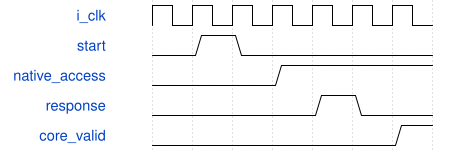

# road_feature_workstore_top 模块规范

> RTL: `rtl/road_feature_workstore_top.v`

## 1. 模块目的

未提供模块目的。

## 2. 参数

| 参数 | 默认值 | 说明 |
| --- | --- | --- |
| — | — | 本模块没有可配置参数。 |

## 3. 时钟与复位

- 时钟：`{"name": "i_clk", "edge": "posedge", "frequency_mhz": 100}`
- 复位：`{"name": "i_rstn", "active": "low", "synchronous": false}`

## 4. 接口信号规范

| 信号 | 方向 | 位宽 | 时钟域 | 语义角色 | 描述 |
| --- | --- | --- | --- | --- | --- |
| `i_clk` | input | 1 | 未声明 | native | 与算术owner同域100MHz |
| `i_rstn` | input | 1 | 未声明 | native | 共同异步复位，服务同时撤销旧响应 |
| `i_block_id` | input | 4 | 未声明 | native | 仅start握手锁存的固定块编号 |
| `o_block_id` | output | 4 | 未声明 | native | 当前任务身份直到下一次start保持 |
| `i_start` | input | 1 | 未声明 | native | ready时启动一次完整固定图任务 |
| `i_cancel` | input | 1 | 未声明 | native | 取消后故障占有至共同复位 |
| `o_start_ready` | output | 1 | 未声明 | native | 空闲、无故障且表有效 |
| `o_busy` | output | 1 | 未声明 | native | 包含完成拍和故障占有 |
| `o_done` | output | 1 | 未声明 | native | 末阶段可见性确认后单拍完成 |
| `o_fault` | output | 1 | 未声明 | native | 信任边界错误粘滞指示 |
| `o_layer` | output | 3 | 未声明 | native | 当前块内阶段编号 |
| `o_tile_y` | output | 7 | 未声明 | native | 当前四行块起点诊断 |
| `o_tile_x` | output | 8 | 未声明 | native | 当前四列块起点诊断 |
| `o_parameter_valid` | output | 1 | 未声明 | native | 当前参数分片请求有效 |
| `o_parameter_channel` | output | 7 | 未声明 | native | DW通道或PW输出三通道起点 |
| `o_parameter_group` | output | 5 | 未声明 | native | 八输入归约组编号 |
| `o_parameter_window` | output | 3 | 未声明 | native | DW窗口并集宽度，PW为零 |
| `i_parameter_ready` | input | 1 | 未声明 | native | 参数请求被服务接受 |
| `i_parameter_response_valid` | input | 1 | 未声明 | native | 参数响应保持至ready |
| `o_parameter_response_ready` | output | 1 | 未声明 | native | 只消费当前未完成请求 |
| `i_parameter_response_block_id` | input | 4 | 未声明 | native | 响应必须属于当前锁存块 |
| `i_parameter_response_layer` | input | 3 | 未声明 | native | 参数响应阶段身份 |
| `i_parameter_response_channel` | input | 7 | 未声明 | native | 参数响应输出通道身份 |
| `i_parameter_response_group` | input | 5 | 未声明 | native | 参数响应归约组身份 |
| `i_parameter_response_window` | input | 3 | 未声明 | native | 参数响应DW窗口形态 |
| `i_parameter_weight` | input | 192 | 未声明 | native | 三路八输入权重 |
| `i_parameter_data` | input | 248 | 未声明 | native | bias及动态量化字段 |
| `i_parameter_error` | input | 1 | 未声明 | native | 参数服务显式错误 |
| `o_read_valid` | output | 1 | 未声明 | native | 单个16字节行请求有效 |
| `o_read_address` | output | 32 | 未声明 | native | 十六字节对齐逻辑地址 |
| `i_read_ready` | input | 1 | 未声明 | native | 行请求被内存服务接受 |
| `i_read_response_valid` | input | 1 | 未声明 | native | 行响应保持至ready |
| `o_read_response_ready` | output | 1 | 未声明 | native | 只消费当前未完成行请求 |
| `i_read_response_address` | input | 32 | 未声明 | native | 必须匹配请求的对齐地址 |
| `i_read_response_data` | input | 128 | 未声明 | native | 低字节对应地址偏移零 |
| `i_read_error` | input | 1 | 未声明 | native | 内存服务显式读错误 |
| `o_write_valid` | output | 1 | 未声明 | native | 合法核结果写请求 |
| `o_write_address` | output | 32 | 未声明 | native | 完整冻结图字节地址 |
| `o_write_data` | output | 8 | 未声明 | native | 最终饱和INT8结果 |
| `o_write_sum` | output | 9 | 未声明 | native | 饱和前signed9残差和 |
| `i_write_ready` | input | 1 | 未声明 | native | 外部写服务接受 |
| `o_barrier_valid` | output | 1 | 未声明 | native | 当前整层全部写接受后的屏障 |
| `i_barrier_ready` | input | 1 | 未声明 | native | 此层此前写已经可读 |
| `i_barrier_block_id` | input | 4 | 未声明 | native | 屏障必须属于当前锁存块 |
| `i_barrier_layer` | input | 3 | 未声明 | native | 屏障确认所属阶段 |
| `i_table_valid` | input | 1 | 未声明 | native | 原owner装表有效 |
| `i_table_addr` | input | 10 | 未声明 | native | 共享SiLU表地址 |
| `i_table_data` | input | 16 | 未声明 | native | 同包Q7.8表项 |
| `o_table_ready` | output | 1 | 未声明 | native | 实际表项接受 |
| `o_table_loaded` | output | 1 | 未声明 | native | 1024项已装满许可 |

## 5. 周期行为与延迟

- 实际固定feature客户、唯一WIF1仓及冻结算术owner直接接线
- 全部数据接口外露且无常量测试数据替代运算路径
- 共同reset且SiLU重新装表后才接任务；故障合并不掩盖
- 仅诊断综合，不是板级引脚或整网顶层

## 6. WaveDrom 时序图

### 请求到真实提交后响应

具体周期以厂商模型测量为准；核心II不变

- WaveJSON：[road_feature_workstore_top_native-store.json5](waveforms/road_feature_workstore_top_native-store.json5)

## 7. 边界、反压与错误

- byte/weight响应等待和背压
- 共同复位取消旧响应，工作内容重新覆盖
- SPPF池化不经过MAC

## 8. CDC 与综合约束

- 100MHz同域，无新增时序例外
- 共享仓4ERAM由实际综合确认，原核II/数值/复位不变
- 只诊断综合，不运行布局布线或位流

## 9. 验证与验收

- 与回归TB相同client/workstore/core源闭包和端口映射
- 综合硬RAM及算术路径实际保留检查

## 10. 可追溯性

- 规格模块：`road_feature_workstore_top`
- RTL 路径：`rtl/road_feature_workstore_top.v`
- 交付要求：本文档、WaveJSON 和 SVG 必须与同一版本规格一同发布。
