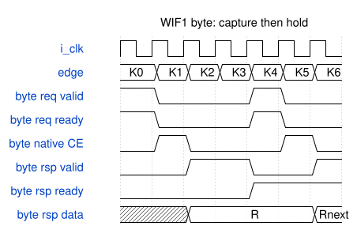
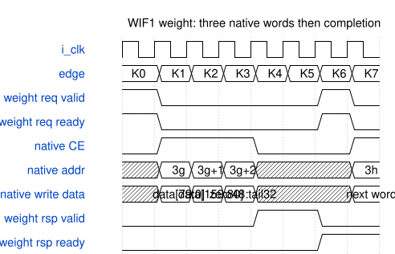

# road_feature_workstore 模块规范

> RTL: `rtl/road_feature_workstore.v`

## 1. 模块目的

WIF1唯一四块PH1P_LOGIC_ERAM工作仓：两2048×8字节bank、两512×40并行权重片。接口保持第七批WIF1，单未退休事务每通道独立。

## 2. 参数

| 参数 | 默认值 | 说明 |
| --- | --- | --- |
| — | — | 本模块没有可配置参数。 |

## 3. 时钟与复位

- 时钟：`{"signal": "i_clk", "edge": "posedge", "frequency_hz": 100000000}`
- 复位：`{"signal": "i_rstn", "active_level": 0, "assertion": "asynchronous", "release": "共同域协调释放；使用前保证有效复位沿；释放后首个正常上升沿置flag_running，之后才允许握手", "transaction_cancellation": "立即关闭native CE/WE，清valid和阶段；已提交内容不回滚，全部所用范围必须重写", "memory": "rsta/rstb固定0；内容不复位；INIT_FILE/FILL_ALL=NONE"}`

## 4. 接口信号规范

| 信号 | 方向 | 位宽 | 时钟域 | 语义角色 | 描述 |
| --- | --- | --- | --- | --- | --- |
| `i_clk` | input | 1 | i_clk | clock | 共同100MHz上升沿时钟 |
| `i_rstn` | input | 1 | i_clk | reset | 低有效复位取消事务但不清RAM |
| `i_byte_req_valid` | input | 1 | i_clk | byte request valid | 源保持至valid与ready握手 |
| `i_byte_req_write` | input | 1 | i_clk | byte request direction | 1写0读 |
| `i_byte_req_addr` | input | 12 | i_clk | byte request address | 仅0..3071合法 |
| `i_byte_req_data` | input | 8 | i_clk | byte request payload | 写入的原始八位数据 |
| `i_byte_rsp_ready` | input | 1 | i_clk | byte response ready | 消费字节响应 |
| `i_weight_req_valid` | input | 1 | i_clk | weight request valid | 整组请求有效并保持至握手 |
| `i_weight_req_write` | input | 1 | i_clk | weight request direction | 1写整组0读整组 |
| `i_weight_req_group` | input | 5 | i_clk | weight request group | 仅0..23合法 |
| `i_weight_req_data` | input | 192 | i_clk | weight request payload | 低位先存三个80位word |
| `i_weight_rsp_ready` | input | 1 | i_clk | weight response ready | 消费已完成的整组响应 |
| `o_byte_req_ready` | output | 1 | i_clk | byte request ready | 仅无native未完成且响应可退休时接纳 |
| `o_byte_rsp_valid` | output | 1 | i_clk | byte response valid | native访问后捕获并完成 |
| `o_byte_rsp_data` | output | 8 | i_clk | byte response payload | 读结果或写及错误的零 |
| `o_byte_rsp_error` | output | 1 | i_clk | byte response error | 非法地址完成标记 |
| `o_weight_req_ready` | output | 1 | i_clk | weight request ready | 三word空闲且响应可退休时接纳 |
| `o_weight_rsp_valid` | output | 1 | i_clk | weight response valid | 末word提交或取得后发布 |
| `o_weight_rsp_data` | output | 192 | i_clk | weight response payload | 原始整组读数据或写及错误的零 |
| `o_weight_rsp_error` | output | 1 | i_clk | weight response error | 非法组号完成标记 |
| `o_fault` | output | 1 | i_clk | sticky fault | 任一非法握手置1共同复位清0 |

## 5. 周期行为与延迟

- K0为请求valid&&ready采样沿，K1等为之后的上升沿；所有响应描述指沿后NBA稳定值，最早消费在其后沿。
- byte：K0锁存地址/方向/载荷/非法；K1合法事务访问所选bank A口；K2捕获已同步取得的读值或发布data0写/非法响应。固定接受至rsp_valid为2周期。
- weight：地址base=3*group，K1/K2/K3同时访问两40位片地址base/base+1/base+2；读在K2/K3/K4捕获前一沿结果，K4 rsp_valid。写K3提交最后word后，K4才确认；固定接受至rsp_valid为4周期。
- 80位word0=data[79:0]，word1=data[159:80]，word2={48'd0,data[191:160]}；每word低40位入weight_lower，高40位入weight_upper；末word只读lower[31:0]。
- 两通道可并行，无跨通道仲裁依赖；各自valid&&!ready时payload/error/valid全保持。req_ready只在native流水空且响应槽空或旧响应即将消费时有效。
- 非法byte addr3072..4095及weight group24..31与合法事务采用相同响应延迟，但所有CE/WE保持0，响应error1/data0；fault在非法请求K0握手后即置1，合法请求不清除。
- reset取消所有旧valid/阶段；部分权重写可能已提交但无完成响应，client必须重写整组及任务所用字节范围。没有内容回滚、覆盖检测硬件或外部DDR排空承诺。
- native同步读假设源自同工程SP/NOREG真实ROM配置和官方公共参数；本代理不运行ModelSim/TD，实际模型延迟和最终4ERAM映射须总协调实测确认。

## 6. WaveDrom 时序图

### 字节同步访问、反压及同拍退休接纳

图中沿K0接受，K1 native，K2响应沿后有效，K4沿消费旧响应并接受新请求。data=R期间保持。仅说明接口合同，实际厂商模型时序须实测。

- WaveJSON：[road_feature_workstore_byte-backpressure.json5](waveforms/road_feature_workstore_byte-backpressure.json5)

### 权重三word原生提交与同步拼装

K1/K2/K3同址并行访问两40位片；读在K2/K3/K4捕获，写在K3提交末word，二者K4沿后发布。K6沿退休并接受下一组。

- WaveJSON：[road_feature_workstore_weight-words.json5](waveforms/road_feature_workstore_weight-words.json5)

## 7. 边界、反压与错误

- 边界byte 0/2047/2048/3071及非法3072/4095；weight0/23及非法24/31。
- 同通道未退休期间不得再接受；响应ready与新req_valid同沿可分别退休和接受；源在req_valid&&!ready时保持全部请求payload。
- weight读前必须完整写入三个word，不依赖初值；共同reset后重新覆盖本任务所用内容。
- reset在byte提交前/后、weight三个写沿中间、同步读等待中或响应反压时取消旧响应；内容可能部分保留。
- 非法事务不影响另一通道；fault粘滞但不阻止合法后续访问。
- 最早连续byte接受间隔3周期、weight5周期（rsp_ready持续1），同拍退休/新接受不增加空拍。

## 8. CDC 与综合约束

- 唯一100MHz共同域；没有CDC，外部保证同域payload与复位释放。
- 四显式PH1P_LOGIC_ERAM；MODE=SP、REGMODE_A/B=NOREG、WRITEMODE=NORMAL、BYTE_ENABLE=0、CLKMODE=ASYNC、IMPLEMENT=20K、FORCE_KEEP=ON；保留属性不是实际映射数量证据。
- 字节每块2048×8共4096B物理容量，逻辑只开放3072B；高bank仅0..1023使用。权重每片512×40，逻辑只用地址0..71。
- 所有B端口CE/WE=0，rsta/rstb=0；不使用写时输出，也不利用读写同址碰撞或上电初值。
- 不得改冻结核端口/II/数值、生产顶层或旧源；本交付不含ModelSim/TD/布局布线/位流/板测。
- 严格门禁原始失败必须保留；纯接口source只供静态位宽检查，不得用于功能仿真或综合。

## 9. 验证与验收

- Python整数与存储参考12648项检查PASS；全部3072字节两轮覆盖、24权重两轮覆盖、192位行走、非法隔离、reset不清内容但清本任务覆盖资格。
- 总协调厂商模型TB需要检查每次实际CE/WE、首尾边界、写后读、三个word打包/尾48零、双通道并行、长反压、同拍退休新请求、reset取消旧valid。
- 总协调负例必须证明真实读数据损坏被检查器捕获；不能用未初始化数据作期望结果。
- registered write-spec交叉核验准确21端口，并生成byte与weight独立周期图；严格八门失败按报告保留。
- 实际TD资源/时序及CSP/SPPF同向量回归由总协调独立执行，Python/静态门不作为物理映射或全网证据。

## 10. 可追溯性

- 规格模块：`road_feature_workstore`
- RTL 路径：`rtl/road_feature_workstore.v`
- 交付要求：本文档、WaveJSON 和 SVG 必须与同一版本规格一同发布。
