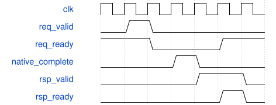

# tb_feature_workstore 模块规范

> RTL: `tb_feature_workstore.v`

## 1. 模块目的

真实四ERAM工作仓握手与存储自检

## 2. 参数

| 参数 | 默认值 | 说明 |
| --- | --- | --- |
| — | — | 本模块没有可配置参数。 |

## 3. 时钟与复位

- 时钟：`{"name": "clk", "period_ns": 10, "domain": "单100MHz测试时钟"}`
- 复位：`{"name": "rstn", "active_level": 0, "semantics": "共同异步低有效取消客户端/仓/算术owner及服务旧响应；RAM不清内容，使用前重写。"}`

## 4. 接口信号规范

| 信号 | 方向 | 位宽 | 时钟域 | 语义角色 | 描述 |
| --- | --- | --- | --- | --- | --- |
| `o_test_complete` | output | 1 | clk | completion | 全部本case实际比较和账本通过后置一；fatal不能完成。 |

## 5. 周期行为与延迟

- 只在valid&&ready登记请求及退休响应；黄金数组在TB且读取前检查written。
- 合法byte一次native访问；weight连续三word，每word80bit，第三word高48清零；完成响应不得早于提交。
- 等待响应时payload必须保持；同时独立两通道请求及响应退休同拍新req。

## 6. WaveDrom 时序图

### 请求完成与反压

示意合法请求、native完成后响应保持至消费；不声明固定native延迟。

- WaveJSON：[tb_feature_workstore_held-response.json5](waveforms/tb_feature_workstore_held-response.json5)

## 7. 边界、反压与错误

- CASE=1响应长反压、请求阻塞和同拍退休接新请求。
- 共同reset取消旧响应，重新覆盖全部使用范围，内容初值无效。
- 负例必须实际数据比较失败并fatal，不能仅打印负例标志。

## 8. CDC 与综合约束

- 仅自检testbench，不可综合，不替代真实厂商RAM模型。
- ModelSim与TD由root统一执行；watchdog只是功能超时，不证明1FPS。

## 9. 验证与验收

- CASE0普通边界及非法sticky；CASE1复位反压；wrapper99用CASE0+NEGATIVE_WORKSTORE=1。

## 10. 可追溯性

- 规格模块：`tb_feature_workstore`
- RTL 路径：`tb_feature_workstore.v`
- 交付要求：本文档、WaveJSON 和 SVG 必须与同一版本规格一同发布。
