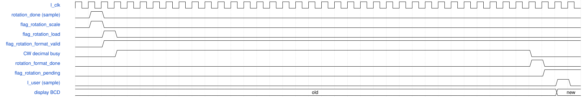
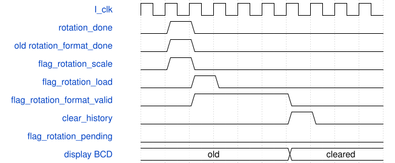

# ball_runtime 模块规范

> RTL: `rtl/ball_runtime.v`

## 1. 模块目的

将源帧实测框送入旋转支路；累计相位的绝对值、缩位和BCD转换分拍执行，最终显示在CSI帧边界整包提交，像素通路延迟不变。

## 2. 参数

| 参数 | 默认值 | 说明 |
| --- | --- | --- |
| C_WIDTH | 1280 | 宽度 |
| C_HEIGHT | 720 | 高度 |
| C_X_MIN | 64 | ROI左界 |
| C_Y_MIN | 160 | ROI上界 |
| C_X_END | 1216 | ROI右界 |
| C_Y_END | 640 | ROI下界 |
| C_GATE_MIN | 544 | 门区左界 |
| C_GATE_END | 736 | 门区右界 |
| C_LINE | 640 | 计数线 |
| C_HYST | 16 | 计数迟滞 |
| C_MIN_AREA | 128 | 最小颜色面积 |
| C_MIN_SIZE | 12 | 最小球框 |
| C_MAX_SIZE | 384 | 最大球框 |
| C_MAX_MOVE | 64 | 关联距离 |
| C_DEBOUNCE | 2100000 | 按键消抖 |
| C_LONG_PRESS | 103520000 | 长按时间 |
| C_FACE_GATE | 0 | 独立旋转工程默认关闭人脸门禁 |
| C_ROTATION_ENABLE | 1 | 独立旋转工程默认开启旋转支路 |
| C_ROTATION_CLOCK_HZ | 103520000 | 旋转时间戳标定 |
| C_FACE_STUMPS | E:/project/ball/fpga/applications/ball_rotation/rtl/face_rom/stumps.mem | 保留人脸支路参数，默认关闭时不实例化门禁硬件 |
| C_FACE_STAGES | E:/project/ball/fpga/applications/ball_rotation/rtl/face_rom/stages.mem | 保留人脸支路参数，默认关闭时不实例化门禁硬件 |
| C_FACE_COORDINATES | E:/project/ball/fpga/applications/ball_rotation/rtl/face_rom/coordinates.mem | 保留人脸支路参数，默认关闭时不实例化门禁硬件 |

## 3. 时钟与复位

- 时钟：`{"name": "I_clk", "edge": "posedge"}`
- 复位：`{"name": "I_rst_n", "active": "low", "synchronous": false}`

## 4. 接口信号规范

| 信号 | 方向 | 位宽 | 时钟域 | 语义角色 | 描述 |
| --- | --- | --- | --- | --- | --- |
| `I_clk` | input | 1 | I_clk | clock | I_clk |
| `I_rst_n` | input | 1 | I_clk | reset | I_rst_n |
| `I_keys_n` | input | 4 | I_clk | signal | I_keys_n |
| `I_camera_status` | input | 48 | I_clk | status | I_camera_status |
| `I_rgb` | input | 96 | I_clk | signal | I_rgb |
| `I_valid` | input | 1 | I_clk | status | I_valid |
| `I_user` | input | 1 | I_clk | signal | I_user |
| `I_last` | input | 1 | I_clk | signal | I_last |
| `O_data` | output | 128 | I_clk | data | O_data |
| `O_valid` | output | 1 | I_clk | status | O_valid |
| `O_last` | output | 1 | I_clk | signal | O_last |
| `O_done` | output | 1 | I_clk | status | O_done |
| `O_early` | output | 1 | I_clk | signal | O_early |
| `O_error` | output | 1 | I_clk | signal | O_error |
| `O_red` | output | 32 | I_clk | signal | O_red |
| `O_green` | output | 32 | I_clk | signal | O_green |
| `O_yellow` | output | 32 | I_clk | signal | O_yellow |
| `O_total` | output | 34 | I_clk | signal | O_total |
| `O_count_mode` | output | 1 | I_clk | control | O_count_mode |
| `O_gate_state` | output | 3 | I_clk | signal | O_gate_state |
| `O_track_status` | output | 2 | I_clk | status | O_track_status |
| `O_camera_step` | output | 2 | I_clk | signal | O_camera_step |

## 5. 周期行为与延迟

- 默认C_FACE_GATE=0、C_ROTATION_ENABLE=1；旋转仅在追踪模式、解锁且图像宽高均不小于256时启用，计数模式维持原计数通路。
- 源帧号、epoch及SOF时间戳贯穿像素缓存、CCL与实测框；漏检后的预测框不作为角度观测。
- 在上升沿n接受rotation_done且rotation_epoch等于active_epoch：冻结48位累计相位绝对值、RPM幅值、角度换算值、方向圈数及状态，并撤销旧的待发布结果。
- 上升沿n+1对冻结绝对值执行缩位：floor(abs_net*100/65536)。abs_net大于等于65536000时输出99999，否则仅对低26位按64+32+4计算33位乘积，并取[32:16]；无需48位乘100链。
- n+1设置flag_rotation_load；十进制转换器在n+2采样装载，32位CW转换器在n+34输出完成脉冲，runtime在n+35锁存全部已完成的BCD值。较短的角度、RPM和净圈数转换提前完成并保持。
- 若无抢占且epoch持续有效，最早在n+36且I_user为高的上升沿发布整包BCD；实际等待取决于后续CSI帧边界。I_user不会立即发布同拍刚完成的BCD。
- 新的rotation_done优先于旧的scale阶段；完成脉冲只有format_valid且epoch匹配，并且当前没有rotation_done、flag_rotation_scale或flag_rotation_load时才接收，避免旧BCD混入新元数据。
- 输入饱和保留reason=15；仅显示净圈数超99999且输入未饱和时使用reason=14。符号独立保留，缩位仅改变显示数值，不改旋转累计量。
- clear_history、门禁锁定或进入计数模式会清理scale/load/format_valid/pending及显示有效状态；rotation_fault在I_user边界发布fault状态并撤销角度和RPM有效标志。
- 视频仍按原front、overlay、OSD与128位打包路径运行；显示数值增加内部准备阶段，不增加像素数据的寄存器级数。

## 6. WaveDrom 时序图

### 旋转显示数值的捕获、缩位与帧边界发布

列表示每个I_clk上升沿之后的寄存器状态；第1列空闲，第2列为捕获沿n。图中32位BCD循环完整展开；未发生抢占且下一次I_user位于n+36。该图为RTL契约示意，不是实测波形。

- WaveJSON：[ball_runtime_display-pipeline.json5](waveforms/ball_runtime_display-pipeline.json5)

### 新结果抢占旧BCD完成与清零撤销

逻辑事件示意：旧转换完成与新rotation_done同拍时拒绝旧完成，下一拍缩位再下一拍装载；随后清零撤销待转换和待显示状态。长BCD转换过程省略，不表示固定帧间隔。

- WaveJSON：[ball_runtime_preemption.json5](waveforms/ball_runtime_preemption.json5)

## 7. 边界、反压与错误

- 48位有符号净相位最小值-2^47的无符号绝对值应保持2^47，并进入显示饱和。
- abs_net=65535999精确截位结果为99999且不置显示超限；abs_net=65536000及更大值显示99999并置显示超限。
- 新结果分别与旧BCD完成、scale、load同拍时，旧完成脉冲不得提交；新的结果重新启动转换。
- 清零、epoch改变、计数模式切换及故障期间不得发布旧旋转结果。
- 输入saturated与显示上限同时命中时，reason=15优先于reason=14。
- 静止、反转、漏检及标记不可见时，遵守旋转支路有效标志，不把预测坐标当作实测角度。

## 8. CDC 与综合约束

- I_clk为MIPI_RX_BYTE_CLK，默认时间戳标定103520000Hz；I_rst_n为异步低有效复位。
- 保持外部96位RGB输入、128位视频输出、全部视频有效与帧行标记接口，以及原像素延迟。
- C_ROTATION_ENABLE控制旋转综合；图像宽高不足256时旋转支路关闭。
- 缩位乘法的三个移位项先显式扩展为33位，避免Verilog移位操作数过窄导致截断。
- 不得通过放宽时钟、虚假多周期或删除接口约束取得时序通过；实际物理时序以同一源码与SDC的route报告为准。
- RAM不做逐单元复位；清零通过有效位与epoch撤销事务。

## 9. 验证与验收

- sim/tb_ball_rotation_format.v及格式边界向量：正负累计值、最小负数、65536000阈值、输入饱和优先级及新旧转换抢占。
- sim/run_rotation_checks.py --full：8帧RGB整链路及Python定点结果核对。
- 原计数、会话清零、epoch及视频延迟回归。
- 严格generated_deliverable_gate检查修改后的runtime；门禁状态与历史格式问题按报告原样保留，不作为物理时序证据。

## 10. 可追溯性

- 规格模块：`ball_runtime`
- RTL 路径：`rtl/ball_runtime.v`
- 交付要求：本文档、WaveJSON 和 SVG 必须与同一版本规格一同发布。
