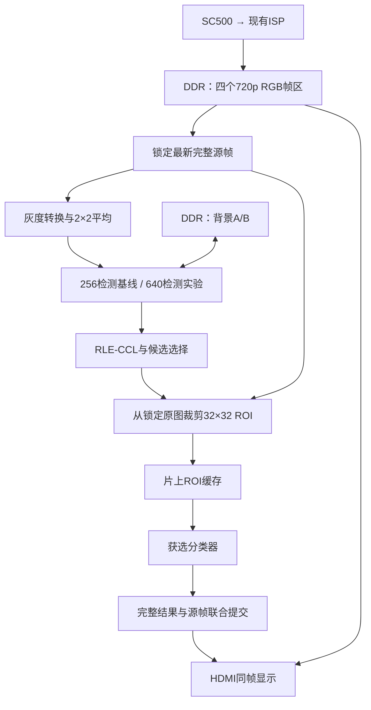

# DDR 道路识别架构设计与实施计划

日期：2026-10-01  
目标工程：`anlogic_topic2_work/lab1_sc500_road_vision`  
状态：架构设计与分阶段验证计划；已完成首轮软件容量诊断，候选升级仍未通过接入门禁。DDR 新架构尚未实现、仿真、综合或布局布线；正式 RTL、模型、验收配置及当前架构记录保持原状。

## 1. 目标与设计依据

采用固定机位，输入保持 1280×720，HDMI 保持现有时序。DDR 保存原始图像和背景，片上 RAM 保存行缓存、ROI 和分类器工作数据。

检测、裁剪、分类及显示使用同一个源帧。HDMI 重复显示最近成功识别的原始图像，图像、框与类别一起更新。

验收目标为成功内容更新至少 15 次/秒、行人召回率 ≥85%、机动车召回率 ≥90%、无效候选误接受率 ≤10%。这些是目标，尚无新架构的实现证据；本次不改变验收配置的冻结状态。

软件先比较当前基线与新方案，再决定是否接入硬件。HOG/SVM 和小型 CNN 分别验证，最终只部署一种。

**将 DDR 高清 ROI 与检测分辨率升级拆开验证。** 保留当前 256×144 检测作为归因基线，在同一候选框上比较旧分析图 ROI 与同帧 720p ROI；640×360 检测是独立实验分支。256 基线本身尚未达到召回目标，不能作为最终方案已经通过的依据。

## 2. 架构与存储安排



| 数据 | 位置 | 设计安排 |
|---|---|---|
| 四张 RGB888 原图 | DDR | 每张 2,764,800 字节，复用现有帧区 |
| 两张 640×360 背景 | DDR | 每张 230,400 字节，各预留 256 KiB |
| 灰度、背景与更新行 | ERAM | 每行 640 字节 |
| 去噪输出双行缓存 | 片上 RAM | 共 160 字节 |
| 32×32 灰度 ROI | ERAM | 1 KiB |
| 分类器工作数据 | ERAM/DSP | 根据获选实现综合核算 |

背景候选字节基址保留 `0x03000000`、`0x03040000`，确认地址单位、容量和帧区范围后才能冻结。适配层统一使用字节地址，负责转换为 DDR IP 地址。

现有 RGB 打包为四组 96 bit 转三组 128 bit，属于紧密 RGB888；不能按每像素四字节计算带宽。

检测灰度公式沿用：

```text
gray = (R >> 2) + (G >> 1) + (B >> 2)
```

随后以 10 bit 累加四个灰度值，右移两位形成 640×360 图像。坐标宽度采用横向 10 bit、纵向 9 bit，面积 18 bit。

上述平均路径只用于 640 分支；256 基线保持原图灰度后每 5 像素点采样。现有阈值、run 门槛和 3×3 窗口在两种分辨率下不自动具有相同语义。640 背景区和坐标宽度是待验证分支的资源预算，不表示同时综合两套检测链。

`MAX_RUN=64`、`MAX_LABEL=32`、四目标上限仅作为初始实验参数。正式容量根据开发场景与压力仿真的 run、累计标签、union 和周期统计确定；不能凭最终目标数量认定容量足够。

已核实当前标签管理器使用前景编号 1～32，编号 0 保留；每帧清零分配计数，union 不回收编号。首轮开发窗口中，640 正常更新配置累计标签需求峰值为 190；不能因此直接把部署容量冻结为 190 或某个二次幂。若研究活跃标签回收，必须证明旧行、父链、特征表及结果中的全部引用已经失效，不能仅凭 union 完成复用编号。

## 3. 数据所有权与协议规则

**帧管理：** 帧区分别记录完整状态、源帧号、采集时间以及写入、算法和显示占用。只有完整帧且写事务完成后才发布。无空闲帧区时丢弃整张新帧，禁止覆盖持有数据。算法最多保留一个执行中或待显示任务。

**DDR：** 摄像头写入、显示读取、算法读写共用调度器。读地址、写地址和写数据分别遵循真实 `valid/ready` 接受条件。核实并接出底层写响应；进入请求 FIFO 不算写入完成。

读归属队列必须先确认返回顺序和每请求返回拍数。64 项队列、32 拍连续调度块及 `2∶2∶1` 配额属于实验起点；配额按数据拍计量。在途请求占用接收缓存预留空间，取消后仍须接收或明确丢弃已接受请求的返回。

**背景：** 背景状态有效性与检测/显示结果有效性分别定义。旧背景只读，新背景完整写入，冻结前景位置也复制旧值；输入、计算或内存事务不完整时废弃新区。原“CCL 失败即撤销背景更新”保留为失败对照，不能直接冻结为正常提交规则。仅在输入完整、更新计算完整且背景质量条件通过后，才研究软件背景更新与 CCL 成功分离；真实 DDR 接入仍需确认完整写入。背景质量与恢复条件未验证前，不采用“失败时无条件学习”。初始化和受控恢复不以 CCL 成功为前提，DDR 故障或容量不足不能直接触发背景重建。

**显示：** 新帧首部准备、旧请求排空、FIFO 跨帧处理和 VSYNC 切换必须形成完整协议。切换条件未满足时继续显示旧图及旧结果。显示 ACK 表示图像与结果已实际切换；旧帧释放还须满足最后一次读取结束。

**CDC：** 像素使用异步 FIFO；描述信息使用稳定快照握手。明确源端保持、目标端捕获、ACK、复位失效和在途排空规则。任务取消不得撤销已发布的显示提交。

零候选属于成功空结果；超时、溢出及协议错误属于失败，不能冒充零目标。

## 4. 分类、调度与实施顺序

候选框映射回锁定的 720p 原图，按固定中心采样规则生成 32×32 ROI。填满 ROI RAM 后再启动分类，避免分类器直接等待 DDR。

候选质量及可用容量通过后，先冻结候选和 ROI，复用既有 HOG64/HOG324 模型做同样本比较，不重新训练或扫描拒识阈值；HOG324 目前只是软件诊断模型，硬件成本尚未证明。三类模型、新训练和 CNN 另需独立数据闭环与候选质量证据。后续 HOG 可复用现有 64 维特征验证行人、机动车、无效候选三类评分；CNN 实验结构为：

```text
32×32×1
→ Conv3×3/8 → ReLU → Pool2
→ Conv3×3/16 → ReLU → Pool2
→ Conv3×3/16 → ReLU
→ 全局平均 → 三类输出
```

CNN 卷积采用 padding=1，使用 INT8 权重、INT32 累加、8 路复用 MAC、两个 8 KiB 特征缓存。供数设计采用输入复用、权重并行读取和独立累加器；舍入、饱和及量化规则先在整数参考中冻结。3,576 个权重及每 ROI 516,144 次 MAC 仅表示计算规模。

取消固定“每四个显示周期一次”的正式调度约束。采用任务完成、提交确认和排空后尽快处理最新完整帧的方式，完整任务周期以具备约 20 次/秒处理能力为设计目标，实际成功输出至少 15 次/秒。45 ms 计算目标和 47 ms 取消阈值仅保留为实验参数，须与提交时间一起验证。

| 阶段 | 工作及交付物 | 进入下一阶段的条件 |
|---|---|---|
| 1. 软件诊断 | 先核实映射、固定 Mask 分区与当前 min-run 对比1；分别比较分辨率及同框高清 ROI，统计容量与耗时 | 分区与映射无错；候选质量和容量有证据，保留全部失败及新增未知候选 |
| 2. 分类器选择 | 候选/ROI冻结后先复用既有模型；新训练或 CNN 待独立数据闭环通过再比较 | 满足完整链路指标与时间约束；宏平均 F1 相差不足 1 个百分点时优先资源更少者 |
| 3. 冻结参考 | 冻结像素处理、背景恢复、容量、裁剪、量化与调度合同 | 有可运行参考和边界测试向量 |
| 4. DDR 与显示平台 | 验证地址、握手、完成响应、在途预算和安全切帧 | 背压、取消、复位及跨帧测试通过 |
| 5. 分级集成 | 检测 → ROI → 获选分类器 → 跟踪与显示 | 各级参考对拍和相关回归通过 |
| 6. 正式验收 | 综合、布局布线和板上连续运行 | 资源、时序、识别指标及成功帧率全部达标 |

任一关键条件未通过，保留实验记录并停止正式接入；保持当前可运行工程。

### 当前软件工作顺序

1. 校验输入与运行收据，从源视频第 0 帧因果回放，容量统计固定为第 120～1079 帧；32 张人工确认帧仅用于对应候选几何评估，不当作独立轨迹或全视频真值。
2. 旁路导出去噪后、min-run 前的二值 Mask；在同一 Mask 上只比较当前门槛与保留全部 run。256 固定为 min-run=2、面积=16；640 固定为 min-run=5、面积=100。两者均保持项目的面积 Top4 和匹配规则，不扫描中间门槛，不修改背景历史。
3. 比较独立 RLE、OpenCV 与项目 Python observer 的像素分区、BBox 和面积，不比较任意标签 ID。生产 RTL 完整分区验证仍是单独门禁；软件参考一致不能代替实际 RTL 证据。
4. 同时报告新增与损失的目标匹配、未知候选和容量需求。现有标注只确认移动人车，没有当前新候选的 invalid 真值；未匹配候选不自动标为 invalid，不虚构 FAR 或 precision。
5. 背景机制实验先完成既有 22 个 invalid 背景子类与 5 个真实目标保护对照的人工复核，不自动补标签。需要外部背景参考时，只采用一个预先固定的 MOG2 软件对照，显式处理阴影值，重新从第 0 帧因果回放；它不直接成为 FPGA 算法。

首轮容量报告位于 [capacity_2415171_20261001_v1/report.md](evaluation/ddr_architecture/capacity_2415171_20261001_v1/report.md)。固定 Mask 审计参考及接入合同见 [审计包 README](external_reference_exploration/ddr_candidate_audit_20261001/README_zh.md)；其独立 union 计数、Top4 并列排序和匹配次级优化与项目不同，适配器保持项目原规则。

## 5. 验证与验收

按视频读写各约 60 fps，视频有效负载约 332 MB/s。算法每任务约搬运 3.36 MB，在 45 ms 内完成需要约 74.6 MB/s 有效服务；必须同时测量最长等待、计算、排空和提交时间。

验证覆盖：

- 坐标编码图、RGB 跨数据拍拼接、灰度平均、边缘与右下角 ROI 的逐像素对拍。
- CCL 密集 run、临时标签耗尽、长合并链、末行 flush，以及容量扩大后的周期变化。
- DDR 独立背压、延迟返回、写响应、缓存预留、取消和复位期间的所有权。
- 背景初始化、失配恢复及真实目标保护；恢复帧单独记录，不计为正常识别成功。
- 显示 FIFO 旧数据、晚到返回和新帧预取，确保图像与框类别始终属于同一帧。
- 场景级训练/验证/测试隔离；按固定 15 Hz 评价时刻、IoU≥0.5 且类别正确的一对一匹配，报告完整链路指标与失败率。
- 全部时序约束有效且无 setup/hold 违例；连续运行 30 分钟，无视频 FIFO 溢出、显示欠载或错帧叠加，成功内容更新至少 15 次/秒。

文档必须区分源码事实、理论估算、实验参数和验证结果。历史资源与时序报告不能作为新架构通过的证据；新版本也不得同时实例化旧整帧灰度缓存和新缓存链。

当前移动目标评价不能支撑停车、停止行人或事故预警能力。帧差为零不等同于无目标；一个 CCL 连通域也不必等于一个道路参与者。容量失败或长期无新观测必须表达感知失效/不确定，不能据此报告道路安全。事件级验收还需连续轨迹及停止、遮挡、重现片段的漏警、误警和失效时间证据，不能用 32 张静态审核帧替代。
