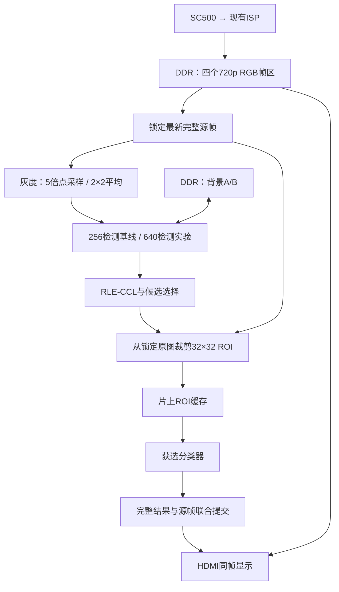

# DDR 道路识别架构设计与实施计划

日期：2026-10-01  
目标工程：`anlogic_topic2_work/lab1_sc500_road_vision`  
状态：架构设计与分阶段验证计划；已完成软件诊断、逐目标账本、扫描上界参考、执行合同自检，以及有限固定 Mask 的本地 CCL RTL 差分仿真。隔离优化尚未通过正式接入门禁。DDR 整机架构尚未实现、仿真、综合或布局布线；生产 RTL、模型、验收配置及当前架构记录保持原状。

## 1. 目标与设计依据

采用固定机位，输入保持 1280×720，HDMI 保持现有时序。DDR 保存原始图像和背景，片上 RAM 保存行缓存、ROI 和分类器工作数据。

检测、裁剪、分类及显示使用同一个源帧。HDMI 重复显示最近成功识别的原始图像，图像、框与类别一起更新。

验收目标为成功内容更新至少 15 次/秒、行人召回率 ≥85%、机动车召回率 ≥90%、无效候选误接受率 ≤10%。这些是目标，尚无新架构的实现证据；本次不改变验收配置的冻结状态。

软件先比较当前基线与新方案，再决定是否接入硬件。HOG/SVM 和小型 CNN 分别验证，最终只部署一种。

**将 DDR 高清 ROI 与检测分辨率升级拆开验证。** 保留当前 256×144 检测作为归因基线，在同一候选框上比较旧分析图 ROI 与同帧 720p ROI；640×360 检测是独立实验分支。256 基线本身尚未达到召回目标，不能作为最终方案已经通过的依据。

## 2. 架构与存储安排



| 数据 | 位置 | 设计安排 |
|---|---|---|
| 四张 RGB888 原图 | DDR | 每张 2,764,800 字节，复用现有帧区 |
| 两张 640×360 背景 | DDR | 每张 230,400 字节，各预留 256 KiB |
| 灰度、背景与更新行 | ERAM | 每行 640 字节 |
| 去噪输出双行缓存 | 片上 RAM | 共 160 字节 |
| 32×32 灰度 ROI | ERAM | 1 KiB |
| 分类器工作数据 | ERAM/DSP | 根据获选实现综合核算 |

背景候选字节基址保留 `0x03000000`、`0x03040000`，确认地址单位、容量和帧区范围后才能冻结。适配层统一使用字节地址，负责转换为 DDR IP 地址。

现有 RGB 打包为四组 96 bit 转三组 128 bit，属于紧密 RGB888；不能按每像素四字节计算带宽。

检测灰度公式沿用：

```text
gray = (R >> 2) + (G >> 1) + (B >> 2)
```

随后以 10 bit 累加四个灰度值，右移两位形成 640×360 图像。坐标宽度采用横向 10 bit、纵向 9 bit，面积 18 bit。

上述平均路径只用于 640 分支；256 基线保持原图灰度后每 5 像素点采样。现有阈值、run 门槛和 3×3 窗口在两种分辨率下不自动具有相同语义。640 背景区和坐标宽度是待验证分支的资源预算，不表示同时综合两套检测链。

`MAX_RUN=64`、`MAX_LABEL=32`、四目标上限仅作为初始实验参数。正式容量根据开发场景与压力仿真的 run、累计标签、union 和周期统计确定；不能凭最终目标数量认定容量足够。

已核实当前标签管理器使用前景编号 1～32，编号 0 保留；每帧清零分配计数，union 不回收编号。首轮开发窗口中，640 正常更新配置累计标签需求峰值为 190；不能因此直接把部署容量冻结为 190 或某个二次幂。若研究活跃标签回收，必须证明旧行、父链、特征表及结果中的全部引用已经失效，不能仅凭 union 完成复用编号。

## 3. 数据所有权与协议规则

**帧管理：** 帧区分别记录完整状态、源帧号、采集时间以及写入、算法和显示占用。只有完整帧且写事务完成后才发布。无空闲帧区时丢弃整张新帧，禁止覆盖持有数据。算法最多保留一个执行中或待显示任务。

**DDR：** 摄像头写入、显示读取、算法读写共用调度器。读地址、写地址和写数据分别遵循真实 `valid/ready` 接受条件。核实并接出底层写响应；进入请求 FIFO 不算写入完成。

读归属队列必须先确认返回顺序和每请求返回拍数。64 项队列、32 拍连续调度块及 `2∶2∶1` 配额属于实验起点；配额按数据拍计量。在途请求占用接收缓存预留空间，取消后仍须接收或明确丢弃已接受请求的返回。

**背景：** 背景状态有效性与检测/显示结果有效性分别定义。旧背景只读，新背景完整写入，冻结前景位置也复制旧值；输入、计算或内存事务不完整时废弃新区。原“CCL 失败即撤销背景更新”保留为失败对照，不能直接冻结为正常提交规则。仅在输入完整、更新计算完整且背景质量条件通过后，才研究软件背景更新与 CCL 成功分离；真实 DDR 接入仍需确认完整写入。背景质量与恢复条件未验证前，不采用“失败时无条件学习”。初始化和受控恢复不以 CCL 成功为前提，DDR 故障或容量不足不能直接触发背景重建。

**显示：** 新帧首部准备、旧请求排空、FIFO 跨帧处理和 VSYNC 切换必须形成完整协议。切换条件未满足时继续显示旧图及旧结果。显示 ACK 表示图像与结果已实际切换；旧帧释放还须满足最后一次读取结束。

**CDC：** 像素使用异步 FIFO；描述信息使用稳定快照握手。明确源端保持、目标端捕获、ACK、复位失效和在途排空规则。任务取消不得撤销已发布的显示提交。

零候选属于成功空结果；超时、溢出及协议错误属于失败，不能冒充零目标。

## 4. 分类、调度与实施顺序

候选框映射回锁定的 720p 原图，按固定中心采样规则生成 32×32 ROI。填满 ROI RAM 后再启动分类，避免分类器直接等待 DDR。

裁剪统一采用源图半开区间 `[xmin*s, (xmax+1)*s) × [ymin*s, (ymax+1)*s)`，不丢最后一行/列。沿用现有 Q8 中心采样：输出位置 u 对应输入索引 `min((W*(4+8*u))>>8, W-1)`，纵向同理。完整 RGB→灰度先转换再裁剪，纯白灰度为 253；不得用默认 resize 代替整数参考。这些规则已有软件边界向量，DDR 跨拍解包与实际 ROI 读路径仍待对拍。

候选质量及可用容量通过后，先冻结候选和 ROI，复用既有 HOG64/HOG324 模型做同样本比较，不重新训练或扫描拒识阈值；HOG324 目前只是软件诊断模型，硬件成本尚未证明。三类模型、新训练和 CNN 另需独立数据闭环与候选质量证据。后续 HOG 可复用现有 64 维特征验证行人、机动车、无效候选三类评分；CNN 实验结构为：

```text
32×32×1
→ Conv3×3/8 → ReLU → Pool2
→ Conv3×3/16 → ReLU → Pool2
→ Conv3×3/16 → ReLU
→ 全局平均 → 三类输出
```

CNN 卷积采用 padding=1，使用 INT8 权重、INT32 累加、8 路复用 MAC、两个 8 KiB 特征缓存。供数设计采用输入复用、权重并行读取和独立累加器；舍入、饱和及量化规则先在整数参考中冻结。3,576 个权重及每 ROI 516,144 次 MAC 仅表示计算规模。

取消固定“每四个显示周期一次”的正式调度约束。采用任务完成、提交确认和排空后尽快处理最新完整帧的方式，完整任务周期以具备约 20 次/秒处理能力为设计目标，实际成功输出至少 15 次/秒。45 ms 计算目标和 47 ms 取消阈值仅保留为实验参数，须与提交时间一起验证。

| 阶段 | 工作及交付物 | 进入下一阶段的条件 |
|---|---|---|
| 1. 软件诊断 | 先核实映射、固定 Mask 分区与当前 min-run 对比1；分别比较分辨率及同框高清 ROI，统计容量与耗时 | 分区与映射无错；候选质量和容量有证据，保留全部失败及新增未知候选 |
| 2. 分类器选择 | 候选/ROI冻结后先复用既有模型；新训练或 CNN 待独立数据闭环通过再比较 | 满足完整链路指标与时间约束；宏平均 F1 相差不足 1 个百分点时优先资源更少者 |
| 3. 冻结参考 | 冻结像素处理、背景恢复、容量、裁剪、量化与调度合同 | 有可运行参考和边界测试向量 |
| 4. DDR 与显示平台 | 验证地址、握手、完成响应、在途预算和安全切帧 | 背压、取消、复位及跨帧测试通过 |
| 5. 分级集成 | 检测 → ROI → 获选分类器 → 跟踪与显示 | 各级参考对拍和相关回归通过 |
| 6. 正式验收 | 综合、布局布线和板上连续运行 | 资源、时序、识别指标及成功帧率全部达标 |

任一关键条件未通过，保留实验记录并停止正式接入；保持当前可运行工程。

### 当前软件工作顺序

1. 校验输入与运行收据，从源视频第 0 帧因果回放，容量统计固定为第 120～1079 帧；32 张人工确认帧仅用于对应候选几何评估，不当作独立轨迹或全视频真值。
2. 旁路导出去噪后、min-run 前的二值 Mask；在同一 Mask 上只比较当前门槛与保留全部 run。256 固定为 min-run=2、面积=16；640 固定为 min-run=5、面积=100。两者均保持项目的面积 Top4 和匹配规则，不扫描中间门槛，不修改背景历史。
3. 比较独立 RLE、OpenCV 与项目 Python observer 的像素分区、BBox 和面积，不比较任意标签 ID。生产 RTL 完整分区验证仍是单独门禁；软件参考一致不能代替实际 RTL 证据。
4. 同时报告新增与损失的目标匹配、未知候选和容量需求。现有标注只确认移动人车，没有当前新候选的 invalid 真值；未匹配候选不自动标为 invalid，不虚构 FAR 或 precision。
5. 背景机制实验先完成既有 22 个 invalid 背景子类与 5 个真实目标保护对照的人工复核，不自动补标签。需要外部背景参考时，只采用一个预先固定的 MOG2 软件对照，显式处理阴影值，重新从第 0 帧因果回放；它不直接成为 FPGA 算法。

首轮容量报告位于 [capacity_2415171_20261001_v1/report.md](evaluation/ddr_architecture/capacity_2415171_20261001_v1/report.md)。固定 Mask 审计参考及接入合同见 [审计包 README](external_reference_exploration/ddr_candidate_audit_20261001/README_zh.md)；其独立 union 计数、Top4 并列排序和匹配次级优化与项目不同，适配器保持项目原规则。

### 固定 Mask 对照结果与下一步决策

以下是单段开发视频的**软件诊断结果**：从第 0 帧回放，统计第 120～1079 帧，共 960 帧；几何匹配仅用 32 张人工确认帧中的 46 次行人、11 次机动车观测，属于四条相关轨迹，不能视为独立测试集。固定灰度、去噪、背景历史、面积门槛、Top4 和 IoU≥0.5，仅改变 min-run。

| 配置 | min-run | Top4 行人匹配 | Top4 机动车匹配 | 累计标签峰值 | 超过 32 标签或 64 run 的帧数 |
|---|---:|---:|---:|---:|---:|
| 256 基线 | 2 | 11/46 | 3/11 | 121 | 833/960 |
| 256 保留全部 run | 1 | 15/46 | 5/11 | 130 | 888/960 |
| 640 实验 | 5 | 5/46 | 2/11 | 190 | 843/960 |
| 640 保留全部 run | 1 | 14/46 | 3/11 | 518 | 960/960 |

当前结果支持“短 run 过滤是候选几何损失的一项因素”；不支持“直接改为 1 即可接入”。640 保留全部 run 后标签需求激增，32 标签配置下所有统计帧都超过容量代理限制；行 run 峰值 31，尚未触及 64。匹配改善也未达到召回目标，且没有分类与 invalid 真值，不能解释为识别准确率提高或误接受率达标。扩大标签容量只解决存储约束，不会自动恢复遗漏目标；518 也不是可冻结的部署容量。

复现入口为 `tools/ddr_fixed_mask_trial.py --self-check` 和 `tools/ddr_fixed_mask_trial.py`，报告位于 [fixed_mask_2415171_20261001_v2/report.md](evaluation/ddr_architecture/fixed_mask_2415171_20261001_v2/report.md)。v1 仅保留原始证据及运行时源码/计划快照，正式引用 v2；v2 统一面积过滤前后的项目候选排序。原首轮容量收据中的计划哈希对应 [修订前快照](evaluation/ddr_architecture/architecture_plan_before_mask_audit_20261001.md)，计划按本次请求修订不代表旧收据被改写。

本轮候选框评价采用像素单元覆盖映射：源图闭区间为 `[xmin*s, ymin*s, (xmax+1)*s-1, (ymax+1)*s-1]`，`s` 为 5 或 2。它与既有参考的“采样点角坐标”用途不同，是本次与首轮诊断一致的评价约定；正式 ROI 裁剪和显示框映射仍需单独冻结并对拍。

以下三项进一步实验保持原参数、原背景历史和原模型；没有扫描 min-run 门槛，没有启用标签回收，没有修改生产 RTL 或背景更新策略。

### 逐目标账本：增益不等于所有目标都改善

正式结果见 [target_change_20261001_v2/report.md](evaluation/ddr_architecture/target_change_20261001_v2/report.md)。从第 0 帧因果回放至 1050，1,862 次去噪 Mask 与保存的 Mask 逐像素一致；生成 912 条四阶段目标记录、456 条变化记录及组件像素重叠图。阶段包括面积过滤前、面积过滤后、Top4、容量代理门禁后的 Top4；另保留 raw/clean/run 的最佳 IoU 与一对一分配。

| 具体观测 | 对照发现 | 设计含义 |
|---|---|---|
| 256，第 300 帧 p01 | 原组件合并，同时发生一对一匹配重分配 | 保留短 run 会改变几何；不能把组件合并直接解释为语义目标粘连 |
| 256 和 640，第 450 帧 p01 | 组件像素未变，被更大组件挤出 Top4 | 放宽 run 门槛不能单独解决排序损失；本轮不同时改排序规则 |
| 256，第 240 帧 p01，capacity_top4 | 组件扩展且容量门禁改变 | 容量拒绝单独报告，不能冒充 Top4 排名变化 |

256 的 Top4 总几何匹配为 14→20，其中新增 8、损失 2；640 为 7→17，其中新增 11、损失 1。当前分支经容量代理门禁后，113 次漏匹配的最后 raw/clean/run 一对一匹配阶段为 none 72、clean 20、run 21。none 仅表示这些阶段没有 IoU≥0.5 的一对一分配，不能据此断言原始前景缺失或背景模型失效。未匹配候选继续保留 unknown。

既有 [evaluation/status.json](evaluation/status.json) 记录了 256 min-run=2→1 的冻结 HOG324 对照：正确定位且类别正确的行人由 7/46 降到 4/46。该历史结果不是本轮新增验证，说明候选几何增益不能代替完整识别效果。正式部署保留原门槛；keep_all 仅为候选实验。

### 容量和扫描：优先保持语义不变的低成本优化

正式结果见 [scan_limit_20261001_v2/report.md](evaluation/ddr_architecture/scan_limit_20261001_v2/report.md)，入口为 `tools/ddr_ccl_scan_reference.py --self-check` 和 `tools/ddr_ccl_scan_reference.py`。实验不回收标签，零号保留；标签位宽为 `ceil(log2(L+1))`。以下容量仅用于验证有限表能容纳本窗口，不能冻结为部署参数。

| 检测/分支 | 实验 L / 标签位宽 | 累计标签峰值 | 容量代理超限帧 | 逻辑数组及上界寄存器位数 | 推导扫描访问减少 |
|---|---|---:|---:|---:|---:|
| 256/current | 128 / 8 | 121 | 0/960 | 12,738 | 77.2% |
| 256/keep_all | 192 / 8 | 130 | 0/960 | 16,514 | 80.2% |
| 640/current | 256 / 9 | 190 | 0/960 | 23,756 | 84.1% |
| 640/keep_all | 1024 / 11 | 518 | 0/960 | 78,288 | 85.1% |

位数按当前源码的父表、特征表含 valid/epoch、原始 run 双银行、带标签 run 双银行、匹配 bitmap 和一个 W 位上界寄存器核算，保持 MAX_RUN=64。未计其余控制寄存器、RAM 物理块取整、端口复制、LUT、DSP 或布局开销；不是综合资源或完整 CCL 总存储。192 容量是否节省物理 ERAM 必须比较综合映射，不能仅凭非二次幂容量判断。

**候选优化：** 当前 row_matcher 对每条 run 扫描完整 1～L bitmap，包括没有重叠标签的 run。保留原始标签升序合并，仅将扫描终点缩到本 run 的最大重叠原始标签 M；M=0 时下一解析拍直接进入分配阶段。扫描访问由 L+1 变为 M+1，保留终止判断。新增一个 W 位寄存器及比较逻辑，不扩大 bitmap，不改变过滤、组件、union 顺序或 Top4。

reset、frame_clear 和每条新 run 开始时清零上界；收齐 previous-row 返回后才解析，最后返回拍的非阻塞赋值在下一拍可见。union 根变化不能重排原始标签。扫描计数须能表达 L+1，不能误缩原 W+1 位计数。父表、特征表、run 标签及 resolver 接口的容量位宽必须联动检查。

四组共 3,840 个过滤 Mask 的软件分区与 OpenCV 一致，44 个自检通过。640/keep_all 全窗口基线扫描访问峰值为 4,057,975（frame 1067），优化峰值为 573,375（frame 1040）；这是两个不同帧的各自最大值，不能作为同帧周期对照。这些是软件推导的扫描状态访问，未含 RAM 返回、union、resolve、选择和背压；同帧 RTL 实测见下文。默认 L=32 未作为正式容量。超限参考仍统计需求，但返回失败且不提供可成功提交的分区，禁止用截断结果冒充空结果。

本窗口优先继续 **256/current 检测＋同帧 720p ROI**，保留原 run 门槛。256/keep_all 几何匹配 15/46 行人、5/11 机动车，所列数组约 2.02 KiB；640/keep_all 为 14/46、3/11，约 9.56 KiB，但历史完整分类结果出现退化，keep_all 继续作为独立实验。两者都未达到验收目标；容量代理零失败或软件数组位数不表示部署成功。640 保留为研究对照；不启用标签回收或新分类器。

### 背景、调度、在途预算的可运行合同

正式参考见 [execution_contracts_20261001_v3/reference_checks.json](evaluation/ddr_architecture/execution_contracts_20261001_v3/reference_checks.json)，入口为 `tools/ddr_execution_contract_reference.py`。它是软件断言和理想时间戳例子，没有模拟真实 DDR、CDC 或显示 FIFO。v1/v2 保留原始工件及运行源码，正式引用 v3。

| 输入/更新/写入完整且质量通过 | CCL 完整成功 | 正常背景可提交 | 检测成功可发布 |
|---|---|---|---|
| 是 | 是 | 是 | 是，包括零候选 |
| 是 | 否 | 仅显式开启独立提交实验后可提交 | 否 |
| 否 | 是或否 | 否 | 否 |
| 初始化或受控恢复事务 | 不作为条件 | 按独立初始化/恢复合同处理 | 否，不计正常成功 |

独立背景提交默认关闭。背景质量门禁尚缺人工证据；输入/计算/写响应任一不完整、场景失配或质量未确认均不得学习新区。CCL 容量失败和 DDR 故障不能直接触发重建。任务使用的 background_version 保持不变，新背景版本只供后续任务；旧显示结果保留自己的 source_frame_id 和 background_version_used，禁止套用新背景的框。

背景只随实际消费的新完整源帧推进：丢弃帧不参与学习，同一源帧不能重复计为成功更新。记录源帧号、捕获时间、使用的背景版本、任务开始、结果就绪、显示提交、下一任务开始和失败原因。低频调度实验必须按此重放，不能先逐源帧更新背景后只抽取输出。本轮保持原视频因果历史，尚未验证实际消费帧历史的识别效果。

缓存恒满足 `occupied + reserved ≤ depth`，归属队列项数另受 owner_slots 约束；请求只有 valid/ready 真正接受才按返回拍数预留。取消只标记丢弃，最后返回前不释放归属或预留；FIFO 的旧数据仍须排空。软件覆盖取消、容量拒绝、重复返回和排空前 reset 拒绝。该模型假定同通道按请求顺序返回；真实 IP 返回顺序、跨 ID 乱序、复位晚到返回及 ID 回绕仍待核实。64 项队列不代表可接受 64 个任意长度突发。

ROI 检查覆盖 640/256 右下角半开区间、纯白灰度 253、2×2 放大、32×32 恒等，以及 720p 右下角 20×20 裁剪到 32×32 的组合中心采样。未包含 RGB 跨数据拍解包和 DDR 读响应，不能称高清 DDR ROI 全链已对拍。

完整任务预算包括计算、不能重叠的排空/准备、等待 VSYNC、显示 ACK 和旧帧最后读取释放。理想 60 Hz 例子中，45 ms 计算＋1 ms 准备＋2 ms 释放稳定跨 3 个显示周期，约 20 次/秒；准备改成 5 ms 则跨 4 个周期，约 15 次/秒。假定固定耗时、无争用且无失败；45 ms 本身不能证明成功更新≥15 Hz。高速例子也保证源帧唯一。正式评估记录成功内容更新、失败率和结果年龄；HDMI 重复旧图不计新更新，固定 15 Hz 评价时刻只能用已提交结果，不能用未来结果补洞。

### 生产 CCL 待验证风险与接入门禁

源码复核发现两项优先风险：rle_ccl_top 聚合错误，但 Top4 的逐对象流未直接以 ccl_error 门控，foreground_ccl_top 的分类器及导出流仍能接收该流；object_frame_store 已有整帧 discard，不能因此断言板上已显示错误帧。另一个风险是新 analysis_sof/frame_clear 可清除未完成的 resolve/select。两项已由原核心本地故障探针复现，并由下述隔离任务保护层串联验证处理；**生产路径仍未接入保护层**，分类、跟踪、事件和显示出口尚未证明统一受保护。

原生产 CCL 固定 Mask、隔离扫描优化、满表/溢出后的空帧和正常帧、长 union 链、末行 flush、有限合法间隙，以及任务保护层的忙时输入隔离与失败发布检查已完成。下一步补齐保护层严格门禁、真实行缓存/DDR排空和统一出口接线，再取得综合资源及器件时序证据；不继续扩展扫描优化，不启用回收。每次只改一项，失败时保留工件并停止正式接入。

用户已在本任务中明确批准使用本机已有 Icarus，覆盖 readable-verilog-generator 的依赖/远端替代路径限制；未安装 erie-remote-ssh、WaveDrom 或配置远端。以下为本次本地验证的八项公开状态，不能概括为严格门禁全部通过：

| 门禁 | 本轮状态 |
|---|---|
| compile | 隔离 row_matcher 的 Verilog-2001 编译成功；有限 CCL 测试集的 Icarus 编译成功 |
| AST | formatter 严格门禁未完成，不能声明通过 |
| readability | 严格门禁未完成，不能声明通过 |
| comment | 严格门禁未完成，不能声明通过 |
| naming | 严格门禁未完成，不能声明通过 |
| profile | 严格门禁未完成，不能声明通过；沿用基线状态机风格，未为实验重写 FSM |
| testbench | 有限 CCL 对拍、确定性边界及两个已有回归通过；不覆盖 DDR/CDC/显示或全部压力 |
| toolchain | 经用户批准的本地 Icarus/vvp 实际运行成功；综合/布局布线/远端证据未取得 |

generated_deliverable_gate 对隔离 row_matcher 再次尝试，数分钟无输出/报告后中止，状态为未完成；不能报 PASS，也不能据此判断 RTL 编译失败。严格格式门禁与完整时序/资源门禁补齐前，不接入生产工程。

各收据记录运行时源码/保护文件哈希；本次计划的旧哈希对应 [运行时计划快照](evaluation/ddr_architecture/fixed_mask_2415171_20261001_v2/architecture_plan_at_run.md)。计划按请求更新，旧收据和固定 Mask 不重写；三个正式新参考均保留 adapter_at_run.py。当前结果不足以批准新架构、模型或验收状态的冻结。

### 本地 RTL 差分验证：已有实测 CCL 周期，尚非整机吞吐

正式结果见 [rtl_ccl_trial_20261001_v1/report.md](evaluation/ddr_architecture/rtl_ccl_trial_20261001_v1/report.md)、[cycles.csv](evaluation/ddr_architecture/rtl_ccl_trial_20261001_v1/cycles.csv) 及 [receipt.json](evaluation/ddr_architecture/rtl_ccl_trial_20261001_v1/receipt.json)。复现小检查：`python tools/ddr_ccl_rtl_trial.py --self-check`；完整有限批次须指定新目录，如 `python tools/ddr_ccl_rtl_trial.py --output evaluation/ddr_architecture/rtl_ccl_trial_rerun`，原工件不得覆盖。

生产文件未修改。优化只存在于 `tests/experimental_ddr_ccl/row_matcher.v`，模块名及端口保持原样，编译时替换生产 row_matcher；其余八个 CCL 模块仍用生产源码。新增一个 LABEL_WIDTH 位上界寄存器、最大值比较和动态扫描终止比较，不增加 RAM、DSP 或标签回收。此为源码结构事实，尚无器件综合资源证据。

测试选择四组配置的累计标签峰值帧，256 两组另取人工帧 300/450，共 8 个真实 Mask；它们不是全窗口最坏周期搜索。原背景历史和 Mask 未变；输入逐行等待 row_done，MIN_AREA=1 用于检查全部组件，不是正式面积门槛 16/100 的候选评价。供数可停顿，因此总周期包含本夹具的像素供数、行处理等待、resolve、select，不代表连续相机链或 DDR 系统运行时间。

| 配置 | 本批所测最大总周期的帧 | 基线总周期 | 优化总周期 | 扫描状态周期：基线→优化 |
|---|---:|---:|---:|---|
| 256/current，L=128 | 1043 | 111,612 | 57,816 | 67,725→13,929 |
| 256/keep_all，L=192 | 450 | 164,720 | 75,637 | 118,309→29,226 |
| 640/current，L=256 | 1039 | 514,173 | 290,411 | 270,364→46,602 |
| 640/keep_all，L=1024 | 1040 | 3,904,448 | 872,898 | 3,604,925→573,375 |

8 个真实 Mask 的基线/优化 FEATURE、UNION、OBJECT、FINAL 语义日志一致，逐 run 标签/new 标志/坐标、union 次序和最终面积框均与整数参考一致，CCL error=0。独立复核进一步从实际 run 和最终父链重建前景像素分区，对拍 Python 与 OpenCV 8 连通分区；包括正常边界帧在内共 13 次重建通过，见 [独立分区复核](evaluation/ddr_architecture/local_regression_20261001/independent_partition_checks.json)。每个真实 Mask 的总周期差恰等于扫描状态周期差，说明本批变化来自去掉空扫描，而非候选输出变化。不能外推为全视频准确率提升或完整任务≥15/20 Hz。

根代理还独立运行了六层未压缩父链 `32→31→29→25→17→1`，事件和最终特征金标通过，总周期 4,620→3,131，扫描周期 2,079→590，见 [长父链结果](evaluation/ddr_architecture/local_regression_20261001/long_parent_chain/report.json)。复现 Mask：128×6，初始32点为 x=4*i；第 y 行将每 2**y 个点的首末 x 间填满，组间保留3个零。已有 `tb_lab1_road_chain` 和 `tb_object_discard` 回归均通过，日志保存在 `evaluation/ddr_architecture/local_regression_20261001/`。

压力探针将两项风险变为明确的本地仿真证据：

- exact32 正常；第 33 个新标签触发 label_overflow/ccl_error，但仍有一个局部对象输出。后续空帧与正常帧恢复无错。必须对整个结果做成功资格门控；已有 object_frame_store 丢弃错误帧的回归通过，不应据此声称板上错误图已显示。
- EOF 后解析/选择尚忙时发布新 SOF，仅第二帧有完成记录，前帧被取消且最后未报告协议错误。该故障探针不计正常性能，证明任务入口必须等待前任务终止；单靠 ccl_error 不能检测这种任务丢失。

任务发布资格和忙时流隔离已由下述隔离实现验证；真实 DDR 在途排空、全部生产出口接入、严格门禁与综合资源/时序仍待完成。正式容量、min-run、分类器、背景恢复仍不冻结；256/current 检测＋同帧高清 ROI 路线继续作为资源较小的研究主线。

本地批次源文件、工具、Mask 与命令可追溯；根代理核对全部生产保护哈希，保存了 128 个工件哈希及运行时源码快照，见 [SNAPSHOT_RECEIPT.json](evaluation/ddr_architecture/rtl_ccl_trial_20261001_v1/SNAPSHOT_RECEIPT.json)。此批收据中的计划哈希对应 [本地运行时计划](evaluation/ddr_architecture/rtl_ccl_trial_20261001_v1/architecture_plan_at_run.md)，本次补入实测记录不重写原收据。

### 本轮评审落实：先保证任务完整，再接入识别链

隔离实现为 `tests/experimental_ddr_ccl/ccl_task_guard.v`，整数参考为 `tools/ddr_ccl_task_guard_reference.py`。仅 `task_valid && task_ready` 接受描述并产生核心清帧；从下一拍开始供数，每个像素、SOF、EOL、EOF事件必须携带所属任务号。忙时请求保持等待，未接受任务的整段事件被拒绝，不能仅屏蔽SOF。已接受任务的错误保持至终态；错误与done同拍时失败优先。

保护层复用 **object_frame_store模块实现**，当前隔离链内实例化一张stage/front表；这不等于自动复用生产路径同一物理实例。done后留一拍FLUSH再提交，保留最后对象与done同拍的数据；检查索引恰为0～count-1、重复对象及迟到对象。失败也有明确终态，公开count=0、rd_valid=0；合法空结果则success=1。HOLD期间描述与表稳定，收到结果ACK后才能接受下一任务。正式接入须重接或替换现有store，并补齐分类/宽高等字段（当前隔离表这些字段置零），避免双实例和分类字段丢失；ROI、分类器只能读取完整成功任务，跟踪与显示亦须接入同一资格合同。

控制寄存器按源码为84 bit：状态3、两个32 bit身份64、原因8、开始标志1、索引bitmap4、声明数量3、取消标志1。不另复制结果描述和错误寄存器；相较首稿少79 bit冗余控制寄存器。**这不含store表和其已有控制位，也不是综合资源结果**；guard的seen_objects与store的stage_valid仍物理并存，不能宣称只有一份bitmap。

正式功能结果见 [task_guard_20261001_v2/report.md](evaluation/ddr_architecture/task_guard_20261001_v2/report.md)，v1及运行源码保持。mock 179项检查通过，17次接受、14次握手终态，另3次分别由RUN/HOLD/CANCEL_DRAIN中的显式复位划断，单独记reset-aborted；不能把复位任务计正常完成。不跨复位的排空区间接受数等于终态数。原/优化CCL各2174项检查、4次接受对应4次终态；exact32成功、exact33明确失败（标签溢出、count0、无公开对象），之后空帧和正常帧成功。A执行时B的4个事件全部隔离，A仍完成，B等待后才接受。mock另覆盖四对象最后一项与done同拍、done/error/object同拍、脉冲错误、重复及缺失索引、FLUSH迟到对象、HOLD稳定、cancel+done同拍及预置result_ready。

取消必须等外部drain_done后才清核心并产生取消终态。核心输出无任务ID，因此ACK必须保证旧任务不会再产生obj/done/error；下一任务不能靠guard猜测晚到返回归属。当前仅验证可信ACK假设，不证明真实DDR或行缓存排空。上游须等接受后才开始完整帧；等待ready期间发送的前缀不能在接受后继续后缀。生产run_detector的部分协议错误仅由复位清除；标签/run容量恢复测试不能外推为所有协议故障均可随SOF恢复，正式接入需明确受控复位与排空策略。

严格门禁分文件报告：v1任务测试台的报告列compile/ast/readability/naming/profile通过、comment失败183项，testbench/toolchain未请求；其compile/ast统计files/modules为0，不能代替功能RTL的解析证据。v2新增向量未重跑此静态报告，不能沿用为v2通过。guard、隔离row_matcher与双行测试台的完整严格门禁未完成；本地Icarus功能编译执行通过。上述八项矩阵保持为原row_matcher批次范围，不是新文件全部门禁通过。

### 正式候选门槛、容量边界与供数压力

[candidate_boundary_20261001_v1/report.md](evaluation/ddr_architecture/candidate_boundary_20261001_v1/report.md) 保留原MIN_AREA=1分区证据，另验证13个有限用例：同8个真实Mask以面积16/100输出时，候选数量、顺序、标签、面积、BBox与整数参考一致，基线与优化一致；15/16/17及99/100/101验证等于面积门槛会被接纳。L128/192分别验证恰好L成功、L+1标签溢出，MAX_RUN64成功、65溢出，并检验后续空帧和正常帧恢复。该批失败时的局部对象仅是诊断；成功资格来自独立任务保护层，不能混淆两批证据。

[same_frame_alignment.csv](evaluation/ddr_architecture/candidate_boundary_20261001_v1/same_frame_alignment.csv) 对齐8个样本的源帧号、Mask SHA、L、min-run、min-area、软件full/limited访问数及RTL扫描数，全部一致。RTL扫描数是任务开始至完成之间、每个上升沿观察row_matcher处于扫描状态4的累计周期，包括终止判断；不含其他状态。640/keep_all第1040帧同帧为3,604,925→573,375；全窗口第1067帧的4,057,975不是本批RTL采样帧。总周期不能与扫描周期混用。

[banked_feed_20261001_v2/report.md](evaluation/ddr_architecture/banked_feed_20261001_v2/report.md) 使用129×8确定性压力Mask，每行64 run、L128、min-run/min-area=1。测试台两个像素行银行并发生产和消费，双满停止生产，消费者等CCL原始run写银行空闲再送下一行，EOL后留4拍flush，仅末行等row_done再送EOF；不再每行等row_done。原/优化核心各以像素间隙0/1运行，共4组通过，逐事件、64个最终组件和Top4均对拍参考；24次停顿起点日志重放均确认双银行占满，8行填充/消费严格0、1交替，末行只结束一次。

baseline gap0/1总周期97,578/97,707，扫描均66,048；优化46,602/46,731，扫描均15,072。间隙改变供数重叠耗时但不改变语义。**这是测试台双银行供数行为，不是已综合行缓存或真实DDR/CDC**；取消残余丢弃仍只有Python银行合同证据，真实缓存取消管线未实现。4拍flush和内部银行可用检查需在正式供数接口中形成明确ready协议，不能作为固定时间猜测直接接相机。

### 识别失败账本：保留当前主线，不把几何收益当分类收益

[roi_failure_ledger_20261001_v2/report.md](evaluation/ddr_architecture/roi_failure_ledger_20261001_v2/report.md) 只重整既有历史候选与冻结HOG324评分，没有重新执行视频、裁剪、模型、训练或阈值扫描。第450帧p01的同一组件从Top4第4降至第6，框和IoU不变；keep_all该未入选框没有独立新评分，CSV明确new_score_provenance及new_independent_score_record，不能把借用同框历史评分计作新识别。

第360帧p01、第690帧p02、第1050帧p02均保持IoU≥0.5，却在候选合并和裁剪改变后由行人变为机动车，浮点与量化评分方向均翻转；不能仅归因量化，也不能据几何改善改默认门槛。组件像素关系为合并，不等同于真实目标语义粘连。保持256/current＋高清ROI主线，keep_all和640分开记录；未匹配新候选继续unknown，无新增invalid真值或准确率结论。

本轮旧收据、输入和生产保护文件已独立核对，85项运行源码哈希通过，已保存运行源码和修订前计划，见 [root_hash_audit.json](evaluation/ddr_architecture/review_resolution_20261001_v1/root_hash_audit.json)。task_guard v1与banked_feed v1对应旧源码快照，补充检查保存v2，不覆盖旧结果；生产RTL、模型、验收配置、status、CURRENT_ARCHITECTURE及REAL_DATA_WORKFLOW保持原状。

下一步顺序：先完成保护层严格门禁及统一分类/跟踪出口接线参考，再实现具有ready及取消排空协议的真实行缓存；随后验证DDR地址/写完成/在途预留、同帧ROI和安全显示提交，最后以器件综合、时序和连续板测证明资源及成功更新率。现阶段不冻结容量，不增加标签回收，不改背景，不扩大模型实验。

## 5. 验证与验收

按视频读写各约 60 fps，视频有效负载约 332 MB/s。算法每任务约搬运 3.36 MB，在 45 ms 内完成需要约 74.6 MB/s 有效服务；必须同时测量最长等待、计算、排空和提交时间。

紧密 RGB888 视频双向负载为 331.776 MB/s；20 任务/秒时算法平均为 67.2 MB/s，合计约 398.976 MB/s，均为有效载荷估算。任务运行时仍需约 74.6 MB/s 算法服务；平均负载及 2∶2∶1 数据拍配额不能证明突发或最长等待达标。256/640 分别测实际搬运量，不能复用预算为已测结果。

验证覆盖：

- 坐标编码图、RGB 跨数据拍拼接、灰度平均、边缘与右下角 ROI 的逐像素对拍。
- CCL 密集 run、临时标签耗尽、长合并链、末行 flush，以及容量扩大后的周期变化。
- DDR 独立背压、延迟返回、写响应、缓存预留、取消和复位期间的所有权。
- 背景初始化、失配恢复及真实目标保护；恢复帧单独记录，不计为正常识别成功。
- 显示 FIFO 旧数据、晚到返回和新帧预取，确保图像与框类别始终属于同一帧。
- 场景级训练/验证/测试隔离；按固定 15 Hz 评价时刻、IoU≥0.5 且类别正确的一对一匹配，报告完整链路指标与失败率。
- 全部时序约束有效且无 setup/hold 违例；连续运行 30 分钟，无视频 FIFO 溢出、显示欠载或错帧叠加，成功内容更新至少 15 次/秒。

文档必须区分源码事实、理论估算、实验参数和验证结果。历史资源与时序报告不能作为新架构通过的证据；新版本也不得同时实例化旧整帧灰度缓存和新缓存链。

当前移动目标评价不能支撑停车、停止行人或事故预警能力。帧差为零不等同于无目标；一个 CCL 连通域也不必等于一个道路参与者。容量失败或长期无新观测必须表达感知失效/不确定，不能据此报告道路安全。事件级验收还需连续轨迹及停止、遮挡、重现片段的漏警、误警和失效时间证据，不能用 32 张静态审核帧替代。
