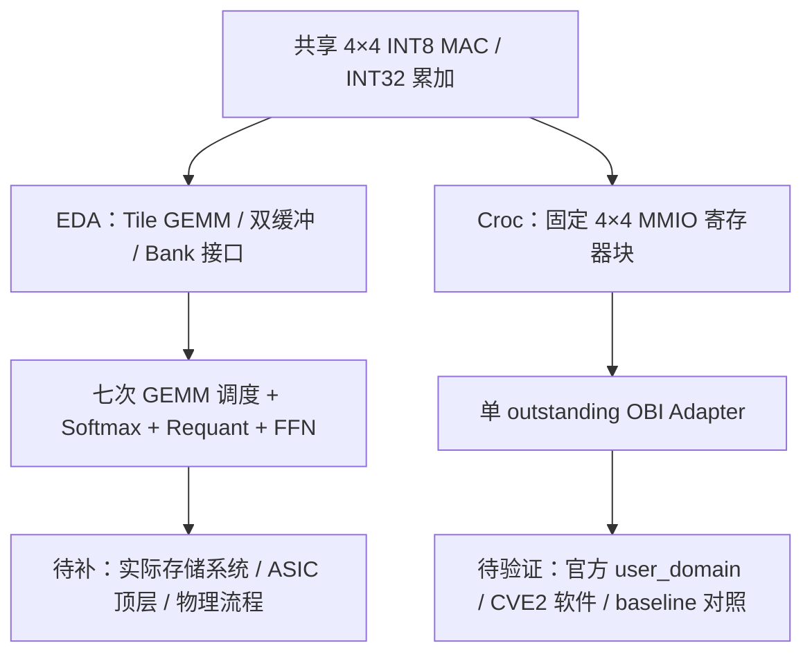

# Transformer + Croc：当前进度、结构与后续路线

日期：2026-10-23。范围：阅读用户提供的两份 Markdown 与两个 ZIP，检查实际源码，并使用本机已有 Icarus 进行有限验证。未修改任何原始 RTL、TB、参考模型或课程文档，未执行 Croc 集成、软件构建、综合或物理设计。解压文件与 ZIP 逐文件哈希一致，见 `evidence/provenance.json`。

## 1. 判断

项目思路成立：复用一个 4×4 INT8 MAC，完成两条不同的课程工程。当前进度是“教学源码与模型已经形成，MAC 已有本轮真实仿真通过证据，两个顶层的真实验证入口尚未闭合”。不能称为完整 Transformer ASIC 或完整 Croc 加速 SoC。

建议保留全局任务书的双主线结构，修改任务先后顺序：先解决真实编译和数值对拍；与此同时复现 Croc baseline、验证工艺与存储可行性。不要先做目录大迁移，也不要继续增加算子。

附件文档中的命令、实施建议和日期作为待评估材料处理。本轮未将它们视为自动授权执行集成或实现的指令。原课程 PDF 未随本轮附件提供，文档所述课程硬性指标属于转述，尚未独立复核。

## 2. 本轮实测进度

环境：Windows 11，Python 3.13.12，Icarus Verilog 12.0 devel。本机 PATH 可找到 `iverilog/vvp`，未找到 `verilator/yosys/bender/openroad`；后者不代表其他机器或容器中不存在。

| 对象 | 本轮结果 | 证明范围 |
|---|---|---|
| 两个 ZIP | 完整性检查通过 | 文件可正常读取；不是功能证明 |
| 两份 MAC | SHA256 完全一致 | 可以冻结为同一算术源码来源 |
| Transformer Python 参考 | 4 个样例、255 个输出值通过 | 参考计算与所给向量一致 |
| Transformer 源码/地址契约 | 静态脚本通过，84 个地址断言 | 不证明 SystemVerilog 声明、展开或时序正确 |
| MAC RTL | 编译与仿真通过 | 有符号极值、clear 优先级、stall、120 次随机/停顿拍 |
| Transformer 全链 | 编译失败，未进入仿真 | 不能标记 RTL_SIM_PASS |
| Croc Python 协议模型 | 1004 次接受/响应通过 | 独立协议模型；不包含真实 GEMM 或 CPU |
| Croc 静态集成检查 | 适配本机 Python/临时目录后通过 | 缩减模板检查；不是官方 SoC 集成 |
| Croc 独立功能与压力 TB | 均编译失败，未进入仿真 | 当前 Icarus 展开不支持所用配置字段写法 |
| Croc CPU 系统、综合、PnR | 本轮未运行，包内亦未提供可信通过证据 | 尚不能评价实际 PPA 或系统加速比 |

原文档“缺少 Icarus，所以 RTL 未验证”的环境结论需要更新为“本机已有 Icarus，已定位真实编译阻塞”。

实测日志：

- `evidence/lesson15/summary.json`、`mac_compile.log`、`mac_rtl.log`、`top_compile.log`。
- `evidence/lesson18/summary.json`、`protocol_model.log`、两个 `*_compile.log`。
- `evidence/lesson18/structure.log` 保存原脚本在 Windows 的 `python3` 别名失败；`structure_current_python.log` 保存将子进程 Python 映射为当前解释器、临时目录设在工作区后的静态检查结果。这些适配仅在内存中生效，原脚本未改。
- `evidence/provenance.json` 保存源包哈希、工具路径和未改原始文件的核对结果。

参考模型还有一项边界：`verify_full_block.py` 从文件中保存的 QKV 输出继续计算，未独立重算全部 `X×W→raw→requant`。因此 255 个值通过应精确描述为“所检查的后续张量与参考一致”，不能升级为完整前端算法已经独立验收。

## 3. 实际结构与共享边界

MAC 是 16 个并行外积乘加单元，A/B 输入按行列广播；当前并非脉动阵列。报告需要据实际连线描述结构。

EDA 七个 GEMM 的形状：

| 阶段 | A | B | 结果 |
|---|---|---|---|
| Q/K/V，三次 | L×D | D×D | L×D，随后量化 |
| Score | L×D | D×L，Key 转置视图 | L×L INT32 |
| PV | L×L，概率编码后 | L×D | L×D INT32 |
| FFN1 | L×D，Attention 量化后 | D×F | L×F，ReLU/量化 |
| FFN2 | L×F | F×D | L×D INT32 |

Softmax 在 Score 和 PV 之间按行运行。当前实现不含 residual、LayerNorm、bias；是否要求增加，必须依据正式题目与教师口径判断，不能仅因标准 Transformer 常见这些结构就扩展范围。

当前应共享 MAC、算术规格和必要测试方法。保留 EDA tiled GEMM 与 Croc 固定 MMIO 控制各自的实现，暂不追求共享完整 GEMM。先使用文件清单和哈希固定来源；目录迁移或公共文件提取应在回归可运行后进行，并逐步复测。

## 4. 必须进入下一阶段任务的具体问题

### 4.1 Transformer TB 声明缺失是确定的源码错误

`lesson15_rtl_validation/lesson14_transformer_full/tb/tb_transformer_block.sv` 在第 102、106、110 行使用 `q_wr_data/key_wr_data/v_wr_data`，但 TB 未声明这三组 32 位信号。顶层第 29 行实际导出这些端口。真实编译报无法绑定。

`reference/static_contracts.py` 只检查端口名字是否出现在 TB 文本中，名字在使用位置出现也会通过。这解释了“静态 PASS，但实际不能编译”。最小修复应落在 TB 声明与对应接口检查，之后重新展开，不能用更多文本匹配代替编译。

GEMM 第 120–121 行的多维 unpacked 数组动态索引还触发 Icarus 内部断言。这是工具兼容阻塞，尚不是算法错误证据。优先用可靠的 SystemVerilog 仿真器交叉检查；若需要兼容改写，应独立保留行为对拍依据，避免同时重构控制逻辑。

### 4.2 Croc 先解决可靠的仿真入口

`lesson18_croc_obi_validation/rtl/croc_gemm_obi.sv` 第 16–17 行使用 `SbrObiCfg.DataWidth/IdWidth` 定义位宽，本机 Icarus 不接受该常量展开。随之产生的 74 位端口告警暂不能独立视为设计宽度错误。

包内已有 Verilator 入口，但仅覆盖功能 TB，尚未覆盖压力 TB；官方 Croc 也使用较完整的 SystemVerilog 类型系统。下一步应确定支持这些类型的实际工具，运行功能与压力两组测试，随后再接官方 SoC。不能为了让独立 stub 编译而把真实 SoC 协议随意简化。

### 4.3 Croc 数值验证过于特殊

独立功能 TB 和 C 程序都只使用 A=单位矩阵，预期结果就是 B。它们可以检查寻址、字节符号扩展和部分数据流，但不能充分检验一般乘法与 K 累加。

最小补充应包括非单位 A、混合正负、-128/127 极值、连续第二次任务，逐元素对照真实 GEMM Golden；另补 busy 时写入和运算/响应期间复位。Python 协议模型不计算 GEMM，且未完整核对响应 rdata，1004 次协议 PASS 不能替代这些测试。

### 4.4 上界参数与实际存储没有闭合

RTL 接受 L=1..64、D/F=1..256；现有四组向量最大仅 L=5、D=9、F=9。参数检查通过不等于最大尺寸功能通过。

以 L=64、D=256、F=256 为例，若五组权重同时驻留且互不覆盖：

- 权重需求为 `3D²+2DF=327680 B=320 KiB`。
- 当前 TB 权重数组为四 Bank、每 Bank 65536 字节，共 256 KiB。
- 每 Bank 实际需要 81920 字节，至少缺 16384 字节；四 Bank 合计缺 64 KiB。

这是当前 TB 容量与上界验证之间的具体缺口；RTL 的 18 位 Bank 地址空间本身并非此处的限制。

若 X/Q/K/V/量化后 Attention/Hidden、Score/P 与五组权重全部独立常驻，数据量约 436 KiB；再常驻 INT32 最终 Y 则约 500 KiB。此数未包括其他调试输出、对齐和外围开销，也不是不可降低的下界：阶段加载、张量生命周期复用可以减少容量。

### 4.5 目前的计算核不是完整物理顶层

`transformer_block_top.sv` 第 3–8 行明确将主要 SRAM Bank 放在模块外，采用固定一拍读响应、写入无背压的契约；TB 提供大数组模拟存储。现在综合这个核得到的面积不包含完整存储系统，不能当成完整加速器面积。

第一周应明确：哪些存储属于 ASIC 顶层、容量/端口/延迟、权重加载方式、输出去向、真实 SRAM 宏或可综合替代。必须核对宏的 Liberty/LEF/GDS/Verilog 等视图与所选工艺是否齐全。

官方 Croc 使用 `tc_sram_impl` 连接技术相关存储，仅支持的 IHP SRAM 配置才有实际实现；不支持的配置可能落为 blackbox。参考：[官方 Croc README](https://github.com/pulp-platform/croc#configuration)。这支持复用其工艺方法，但不证明本项目任意 Bank 配置都能自动映射。

## 5. 建议重排后的路线

| 阶段 | 共享 / EDA | Croc | 可核验结束条件 |
|---|---|---|---|
| 最近 48 小时 | 固定源包；修 TB 接口；确定仿真器；列一页定点/存储契约 | 固定官方 commit 与 Bender.lock；复现原版 Hello World；运行两组独立 OBI TB | 有真实运行日志，明确首个失败点；不再只有模型 PASS |
| 第一周 | MAC→GEMM→Softmax→全链逐级对拍；完成上界存储预算 | 增加非平凡 GEMM；准备实际挂载 diff | 小尺寸验证能跑，问题可定位；容量/端口/延迟方案可解释 |
| 第一周并行 | 最小 MAC/Buffer 的综合与物理流程试跑，检查库、约束、宏、GDS/DRC/LVS 工具链 | 用官方 baseline 验证工具环境 | 真实启动工艺流程并保存阻塞；小模块结果不冒充最终交付 |
| 第二周 | 四组现有样例真实全链对拍；中间张量、最终写回与 done 对齐 | 真实 CPU 写 A/B、start、轮询、读 C，运行多个数值任务 | EDA RTL_SIM_PASS；Croc SYSTEM_PASS |
| 第三周 | 上界/边界回归；带实际存储的顶层工艺综合 | 同库同约束下 baseline/增强版综合 | 无未知 blackbox；面积/关键路径/存储资源口径清楚 |
| 第四至五周 | 完整顶层 PnR、CTS、STA、GDS、DRC/LVS；收集功耗与切换活动 | CPU 纯软件与 MMIO 端到端周期对照、同条件 PPA | 原始报告、版图与可复现数据齐全 |
| 最后阶段 | 设计冻结、干净环境回归、EDA 报告 | 独立 Croc 提交包与报告 | 两门课各自能构建、复现和解释 |

这是任务顺序建议，不是对工期的保证。以原任务书日期窗口为参考，具体截止日期仍以课程通知为准。

与原计划相比最关键的调整：将存储预算和最小物理流程提前到第一周；完整规模回归与最终 PnR 仍按依赖推进。工艺可行性不能等功能做完才第一次检查。

暂缓：完整 GEMM 统一、大阵列、DMA、多头、QKV 融合、多数据流切换、额外精度格式与大规模目录整理。待最小系统、物理可行性和必做交付闭合后，依据实际瓶颈选择一项优化。

性能口径必须包含数据搬运。Croc 应计入输入写入、start、轮询和结果读回，对照相同输入的 CPU 软件总周期；加速比小于 1 也应如实报告。

## 6. 本轮审阅边界

按审阅技能的八项公共矩阵区分：`compile`（技能静态解析）、`ast`、`readability`、`comment`、`naming`、`profile` 均未执行正式工具门禁；`testbench` 已读，确认存在声明与覆盖缺口，未判定通过；`toolchain` 已实际运行 Icarus，MAC 通过，两个系统级验证入口编译失败。上述工具结果不等同于风格或综合认证。

下一阶段的衡量单位应是“一个可复现的验收结果”，而不是新增 Lesson 数或 RTL 文件数。
