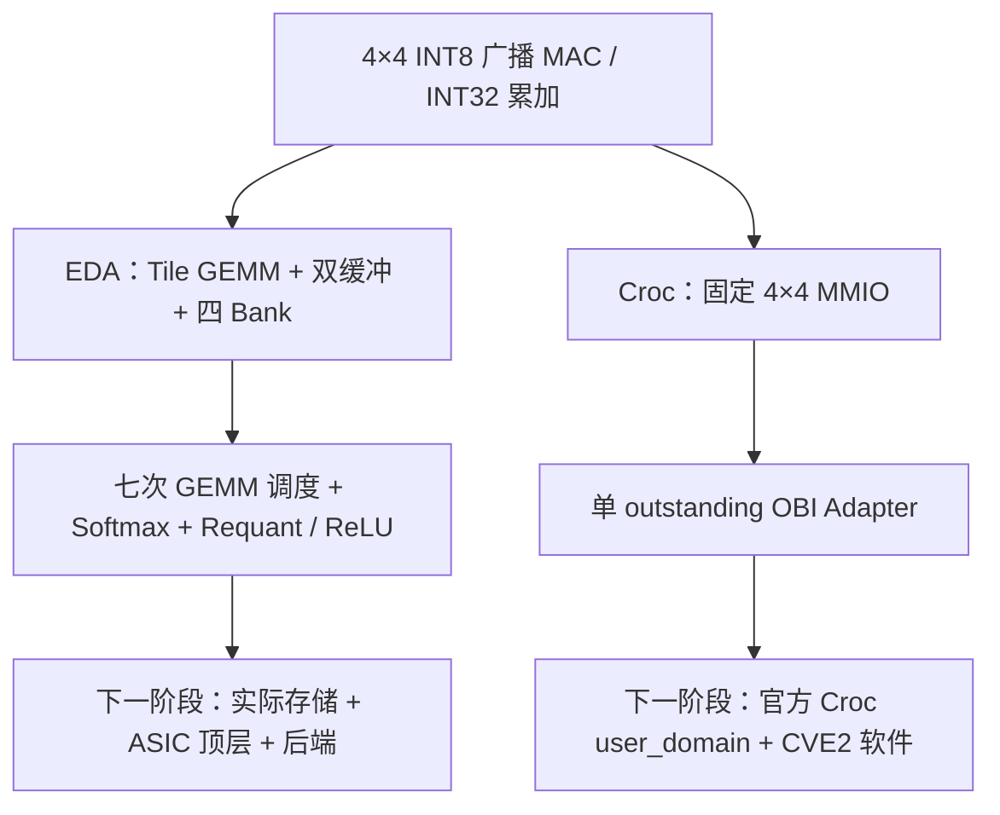

# Transformer + Croc 双课设工程指引

更新日期：2026-10-24。本文对应当前工作副本，原始审阅记录保存在 `review_20261023`。课程 PDF 的正式硬性指标仍需对照原题；本文规定的是工程推进方法与本地验证口径。

## 1. 先运行，再读结果

当前开发根目录：`C:\Users\lenovo\Documents\ChatGPT\magic_road`，开发分支 `codex/transformer-croc-validation`。该分支单独承载双课设工程，远程 `master` 保留已有 Minecraft/world-model 工程。

PowerShell：

```powershell
Set-Location -LiteralPath 'C:\Users\lenovo\Documents\ChatGPT\magic_road'
python run_checks.py
$LASTEXITCODE
```

其他平台进入工程根目录后同样执行 `python run_checks.py`；若系统命令名为 `python3`，使用 `python3 run_checks.py`。子检查沿用同一个 Python 解释器。

需要 Python、NumPy、`iverilog` 和 `vvp`，工具须在 PATH 中。本轮环境为 Python 3.13.12、NumPy 2.4.6、Icarus Verilog 12.0 devel；这记录的是实测组合，不表示只有这些版本可用。验证脚本不自动安装依赖。

本轮通过结果来自正常本机执行权限。Codex 受限 Windows 环境曾使同一 Icarus 在代码生成后无诊断崩溃（`0xC0000005`）；改变临时目录没有解决。遇到该症状，应保留失败记录，再在正常 PowerShell 中运行同一命令或确认工具执行权限，不能忽略退出码或使用崩溃留下的旧产物。

| 查看位置 | 用途 |
|---|---|
| `reports/local_checks.json` | 本次两分支状态、工具路径、源码/向量 SHA256 |
| `reports/transformer.log`、`reports/croc.log` | 两个子验证入口的完整标准输出 |
| `projects/transformer/reports/summary.json` | 参考、契约、MAC、GEMM、Softmax、量化、概率写回与四组顶层 RTL 结果 |
| `projects/croc/reports/summary.json` | 静态、协议模型、功能 TB 与压力 TB 结果 |
| 两项目 `reports/*.log` | 具体失败的编译或仿真信息 |

**判断通过要同时看退出码与本轮 summary。** 根入口要求两个子入口退出 0、生成本轮新 summary、且各自 `gate=RTL_PASS`，才给出汇总 `RTL_PASS`。缺工具、超时、编译失败、仿真失败都不能当作通过。

Transformer 子入口要求 MAC、独立 GEMM、独立 Softmax、量化、概率写回和四组顶层仿真全部通过。单元向量每次由已跟踪的 Python 助手重新生成到 `reports/gemm_unit_vectors`、`reports/softmax_unit_vectors`、`reports/requant_unit_vectors`，生成目录不入 Git；生成或编译失败就不运行对应旧产物。

两个项目从教学包继承的旧 `validation_report.md`、`verification_status.md` 等是历史说明；不要用其文字代替最新 summary 和日志。`--model-only` 只用于参考检查，不作为硬件验收。

单独重跑一个分支：

```console
python projects/transformer/scripts/validate.py --strict
python projects/croc/scripts/validate.py --strict
```

## 2. 当前目录怎么用

```text
magic_road/
  README.md                           总入口
  工程指引.md                          本文
  run_checks.py                       两分支独立 RTL 回归汇总
  projects/
    transformer/
      scripts/validate.py             EDA 分支验证入口
      validation/                     MAC、GEMM、Softmax、量化和写回测试
      lesson14_transformer_full/
        rtl/                          GEMM、Softmax、量化、调度顶层
        tb/                           全链数值和地址对拍
        reference/                    Python 参考与布局检查
        vectors/                      四组固定输入和期望结果
      reports/                        该分支最新日志
    croc/
      rtl/                            MAC、MMIO、OBI Adapter
      tb/                             功能、压力测试与 Croc 类型 stub
      reference/                      独立 Python 协议模型
      sw/                             待在真实 Croc 上运行的 C 程序
      scripts/                        验证与未来集成辅助
      reports/                        该分支最新日志
  reports/                            本轮汇总和阶段验证材料
  review_20261023/                     原始快照、初次失败日志与审阅报告
```

后续只改 `projects` 中的工作副本。先保留两个工程的现有布局；公共 MAC 目前两份内容相同，修改前后核对哈希并让两条路径回归。等回归稳定后，再把公共源码提取为单一来源，不把目录迁移与功能修复混在一起。

## 3. 结构和源码阅读顺序



EDA 路径以 `projects/transformer/lesson14_transformer_full` 为根，建议依次阅读：

1. `rtl/mac_array_4x4.sv`：每拍 16 次乘加，理解 `clear`、`mac_en`、符号扩展和 accumulator。
2. `rtl/tiled_gemm_4x4_banked_compact.sv`：输出 Tile 循环、K 分块、loader/compute 两引擎、双缓冲的 occupied/ready 生命周期。
3. `rtl/transformer_block_top.sv`：七阶段调度、读源选择、写回和 `DRAIN`。
4. `rtl/softmax_row_int32.sv`、`probability_writer.sv`：整行依赖、LUT、除法、概率编码。
5. `rtl/requant_shift_sat.sv`、`ffn_relu_requant.sv`：移位、饱和、ReLU 及地址/标签随数据寄存。
6. `tb/tb_transformer_block.sv` 与对应向量：看每个中间张量、Bank 地址、写次数与七次启动如何被检查。

Croc 路径以 `projects/croc` 为根：`rtl/gemm_mmio_4x4.sv` → `rtl/croc_gemm_obi.sv` → 两个 `tb/tb_croc_gemm_obi*.sv` → `sw/gemm_test.c`。类型 stub 只服务独立测试，实际 SoC 必须使用官方 `croc_pkg.sv`。

一次学习只追一条真实数据：例如跟踪 A[1][2] 和 B[2][3] 如何进入 C[1][3]，然后从 TB 核对该值。能解释一拍行为和验证依据后，再看下一层。

## 4. 修改前必须遵守的契约

| 项目 | 当前约定 |
|---|---|
| 算术 | signed INT8 × INT8，符号扩展后 INT32 累加 |
| QKV/Attention 量化 | 算术右移，负值向负无穷取整，再饱和至 [-128,127]；不是 RNE |
| FFN 隐层 | GEMM → 移位/ReLU/饱和到 [0,127] → GEMM |
| Softmax | 输入 INT32 Score；Q16 的 1/sqrt(D)；指数 LUT；输出 U8 近似概率 |
| P 存储 | `min(127,(prob_u8+1)//2)`，以非负 signed INT8 供给 MAC |
| A/Q/Key/P/ACT/H Bank | `bank=row%4`，`addr=(row//4)*cols+col`，另加适用的 base |
| W/V Bank | `bank=col%4`，`addr=row*ceil(cols/4)+col//4`，另加适用的 base |
| EDA 读存储 | 固定一拍数据+valid 响应；不直接支持任意延迟总线 |
| EDA 写存储 | 无背压，每个有效写必须接受 |
| OBI 接受 | 上升沿 `req && gnt`；响应注册后返回相同 ID |
| OBI 并发 | 一个 outstanding；响应期间撤销 grant；当前类型无 rready |
| 完成语义 | OBI 写响应仅证明该次寄存器事务完成；运算完成另看 STATUS.done |

`requant_shift_sat` 与 `ffn_relu_requant` 都有一级输出寄存器，每个上升沿接收 `in_valid` 对应的数据与标签；无效拍撤销 `out_valid`，数据与标签保持。前者同时寄存 raw、地址、phase 和饱和标记，后者寄存 row/col。两者均无背压，低有效异步复位清零输出。

`probability_writer` 的 `in_ready` 恒为 1，`wr_en/addr/bank/data` 是组合输出；`row_done` 才在接受有效 `in_last` 的上升沿后置位。该模块的复位只清 `row_done`，不屏蔽组合写使能，系统必须在复位期间令上游 `in_valid=0`。这项现有接口契约不能被测试平台自行改成“复位会屏蔽写入”。

全链形状：Q/K/V=`(L×D)(D×D)`，Score=`(L×D)(D×L)`，PV=`(L×L)(L×D)`，FFN1=`(L×D)(D×F)`，FFN2=`(L×F)(F×D)`。

Croc 的当前基址为 `0x20001000`，真实集成时还必须与锁定版本的地址映射核对。

| 偏移 | 含义 |
|---|---|
| `0x00` | CTRL：bit0=start，bit1=清除 done/error |
| `0x04` | STATUS：bit0=busy，bit1=done，bit2=error |
| `0x10..0x1c` | A 的四行，每个 32 位字打包四个 signed INT8，低字节在第 0 列 |
| `0x20..0x2c` | B 的四行，同样打包 |
| `0x40..0x7c` | C 的 16 个 signed INT32，地址为 `0x40+4*(4*r+c)` |

OBI Adapter 只接受对齐的完整字写，非法地址/未对齐/非法字节使能返回错误且不改寄存器；计算中写 A/B 由叶模块置 sticky STATUS.error，不能混淆为 OBI 传输错误。

## 5. 本地 PASS 的范围

2026-10-24 最终统一命令 `python run_checks.py` 实测退出 0，汇总为 `RTL_PASS`（summary 使用 UTC 时间）：

| 用例 | 实际通过结果 |
|---|---|
| MAC | 极值、清零、120 次随机/停顿拍 |
| GEMM 独立单元 | 10 个连续任务：8 个数值任务、174 个结果；2 个缺失响应任务及后续恢复；两种 B 布局的 5×7×256 均为 1599 周期 |
| Softmax 独立单元 | 10 行、391 个输出，1175 拍背压、899 拍输入气泡；4 次非法启动及输出阻塞中复位恢复；129 项 ROM 与数学 LUT 相符 |
| Requant / FFN ReLU 独立单元 | 814 个向量、1628 个输出；移位 0..31、194 个气泡、633 次相邻有效输入、两次异步复位；raw/phase/addr/row/col 和饱和标记逐项对拍 |
| Probability Writer 独立单元 | 全部 256 个 U8 值，L=1/2/5/64 的全部 4126 个位置；4387 个有效拍、331 个气泡，组合写回与寄存完成、异步复位符合契约 |
| Transformer demo / edge_5x7 / random_00 / sat_1x1 | 各完成七次 GEMM；分别为 244 / 1178 / 486 / 139 周期 |
| Transformer Python 参考 | 从 X/W 重算 raw 与量化 QKV，再检查后续张量，共 573 个值 |
| Croc 功能 TB | 两次任务、32 个 Golden 结果、66 次事务、6 次状态轮询 |
| Croc 压力 TB | 17 次请求/响应严格相等，含保持请求、ID、非法访问、busy 写入 |
| Croc Python 协议模型 | 1004 次事务；与真实 RTL 测试分别报告 |

Transformer 四组现有向量覆盖 demo、非整 Tile、极小矩阵与饱和样例，并检查 QKV raw/quant、Score、P、PV、ACT、Hidden、Final、写地址/计数和七阶段顺序。它们是固定输入的真实 RTL 回归，不等于最大尺寸、全部错误场景或算法近似误差已验收。

新增单元覆盖与下一步边界：

| 对象 | 当前实测 | 尚待验证 |
|---|---|---|
| GEMM | 1×1×1、4×4×4、5×7×6、5×7×256；B 普通/转置布局；逐 Bank 请求地址/en、唯一写回、busy/done；单次复位后连续任务 | 最大 M/N、非法维度、busy 时 start、中途 reset；任意延迟存储不在当前接口契约内 |
| Softmax | L=1/2/64，scale=1/4096/65536；INT32 极值、相等值、固定种子随机值、LUT 截断边界；每项输出背压、连续行及复位恢复 | busy 时 start、更多长度/scale 组合；近似精度相对于浮点模型的算法评估 |
| Requant / FFN ReLU | INT32 两端、负数 floor、饱和阈值两侧、32 个 shift；18 位地址六个边界、全部 phase、9 位 row/col 边界；寄存标签、无效拍保持与异步复位 | 未穷举全部 INT32 值与参数组合；顶层标签排空仍由整链回归检查 |
| Probability Writer | 全 U8 数值、L=1/2/5/64 所有合法 row/index、连续有效/末项与气泡、异步复位 | 合法地址最大为 1023，未穷举 16/18 位地址空间；不提供非法输入校验或存储背压 |
| 整链 | 四组固定案例，最大 L=5、D=9、F=9（分属不同案例） | 整链异常/复位、最大配置与实际存储容量 |

GEMM 缺失 A/B 响应只验证 sticky `mem_protocol_error`、写回结构、完成及下次合法 start 清错；现有 RTL 不自动 abort，故注错任务明确记录 `numeric=NOT_CHECKED`。Softmax U8 输出独立舍入，概率和不必为 255，例如 64 个相等值均为 4，总和为 256。

还实测了两项反向验证：把 GEMM 期望值改为 X、把 Softmax 首个期望值从 255 改为 254，均使 vvp 退出 1 且没有最终 PASS。向量恢复后才运行上述完整回归。证据为 `projects/transformer/reports/gemm_unit_negative.log`、`softmax_unit_negative.log`；正常日志为同目录 `gemm_rtl.log`、`softmax_rtl.log`，详细测试契约在 `validation/*_spec.md`。

本轮量化与写回也有独立反向验证：量化首个期望值 -128 改为 -127；概率写回以 `+CORRUPT_EXPECTED` 将首项 255 的期望 127 改为 126。两者均返回 1 并报告不匹配。量化向量已恢复，概率负例通过运行参数启用，不改 DUT。证据为 `requant_unit_negative.log`、`probability_unit_negative.log`；统一入口正常日志为 `requant_rtl.log`、`probability_rtl.log`。

量化 Python oracle 用无界整数除法 `raw // 2**shift`，独立于 RTL 的算术右移。对 signed INT32，shift 24..31 已不存在超出 [-128,127] 的输入，shift 31 结果只可能为 -1 或 0；不能用溢出的阈值伪造饱和覆盖。概率写回验证的是 U8 到 signed INT8 的编码，不是 Softmax 算法近似精度。

Croc 本地使用类型 stub，功能/压力测试验证的是独立 OBI 外设。即使本地全部通过，仍不能写成 CPU→SoC→GEMM 已通过；`sw/gemm_test.c` 在官方 SoC 上的实际构建和运行另行记录。

Python 参考检查、技能静态/风格门禁、外部仿真、综合、布局布线分别报告状态。严格风格规则与教学源码的差异不通过大范围格式重写处理，也不能把风格检查结果当成仿真结果。

`readable-verilog-generator` 此前目录扫描和 GEMM/Softmax 两个 TB 单文件门禁均未纳入 `.sv`，实际 `files/modules/scanned_files` 为 0。原始输出即便显示 `delivery_ready=true`，在本工程也只能记为不适用，不能认定 compile/AST/可读性/注释/命名/profile 已通过。此前原始记录在 `reports/readable`；精简判定为 `projects/transformer/reports/unit_style_gate.json`，含大量规则副本的 `*unit_deliverable*` 原始输出仅保留在本地。本轮新 TB 沿用 `.sv`，不重复空扫描；TB 已人工复核，toolchain 结果采用真实 Icarus 编译与仿真。

## 6. 接下来按什么顺序做

| 阶段 | 具体任务 | 验收材料 |
|---|---|---|
| A：已完成局部闭环 | 编译兼容与 TB 接口修复；四组 Transformer；Croc 功能/压力与非平凡数值测试 | 当前源码哈希、退出码、summary、首个分歧日志 |
| B1：已完成单元切片 | GEMM 转置/尾 Tile/K=256/缺失响应/无复位恢复；Softmax L=64/背压/非法启动/复位 | 两个独立 TB、确定性 Python 向量、逐项对拍、反向验证与完整回归 |
| B2：已完成数据通路单元 | `requant_shift_sat`、`ffn_relu_requant`、`probability_writer` 的移位/饱和/标签与写回时序 | 814 个量化向量、全 U8 编码与 4126 个合法位置；正反向测试和完整回归 |
| B3：下一步控制异常 | GEMM 非法维度、busy 时 start、中途 reset；顶层非法配置/地址范围、busy 重启、关键阶段 reset 后恢复 | 精确检查错误/完成语义、无额外读写、复位后首个任务；最大 M/N 的有界切片另补 |
| C：真实 Croc | 锁定官方 commit/Bender.lock；原版 Hello World；检查实际集成 diff；生成 flist；CPU 多组 GEMM | baseline 与增强版 ELF/UART/事务日志；SYSTEM_PASS |
| D：存储与工艺，立即并行准备 | 定义 ASIC 顶层范围、宏容量/端口/延迟、工艺库/约束；最小 MAC/Buffer 试综合和物理流程 | 宏视图清单、无未知 blackbox 的网表、实际工具报告 |
| E：完整交付 | EDA 完整顶层综合/PnR/CTS/STA/GDS/DRC/LVS；Croc 同条件综合及 CPU 软件对照 | 两门课各自可复现的提交包、报告和截图 |

**B 按独立单元逐项收口，C 与 D 先准备可复现的环境。** 本轮已有可用 Icarus；Verilator、Yosys、Bender、OpenROAD 未在当前 Windows PATH 中发现。正常权限下检查 Ubuntu-24.04 WSL，当前 PATH 也未检出 `verilator`、`yosys`、`bender`、`openroad`、`klayout`、`riscv32-unknown-elf-gcc`、`riscv64-unknown-elf-gcc`。这不证明其他目录没有安装；PDK、标准单元库与 SRAM 宏尚未核验。此次仅检查环境，没有安装或改动配置。

下一次进入 B3 控制异常与复位恢复，沿用当前 `python run_checks.py` 入口与检查点分支。先从实际 RTL 明确“忽略、报错、sticky 或 pulse”的语义，再写失败用例，不为测试方便改变接口。C 先锁定官方 Croc 版本和所需工具版本，跑原版 Hello World，再集成外设；D 先列明工艺库/宏的实际来源与视图、确定分阶段加载或复用的存储方案，再做最小 MAC/Buffer 试综合。工具与库未就绪时，继续本地单元工作，不把工具缺失写成 SoC 或后端通过。

WSL 检查可重跑以下命令。`|| true` 用于继续查询后续工具，整体退出 0 不等于工具齐备，必须查看实际路径输出。当前 WSL 还提示 localhost 代理与 NAT 模式不匹配，联网准备时需先验证可达性。

```powershell
wsl -d Ubuntu-24.04 -- bash -lc 'for x in verilator yosys bender openroad klayout riscv32-unknown-elf-gcc riscv64-unknown-elf-gcc; do command -v "$x" || true; done'
```

存储预算是下一阶段的先决事实：L=64、D=F=256，五组权重全驻留需要 320 KiB，当前 TB 只提供 256 KiB 权重容量。完整独立常驻张量约 436 KiB，加 INT32 最终 Y 约 500 KiB；这不是不能降低的下界。应先选择阶段加载/生命周期复用/真实宏方案，再修改存储接口或扩大缓存。

性能统计须包含搬运。Croc 比较相同输入的 CPU 软件总周期与“写 A/B + start + 轮询 + 读 C”的总周期；EDA 报告明确频率、矩阵尺寸、存储范围和测量阶段。缺少实际库/活动文件时不填功耗，计算核面积也不替代完整存储顶层面积。

暂缓大阵列、DMA、多头、QKV 融合和通用 GEMM 统一。按真实失败或瓶颈选择下一处修改，每次保持“一个问题 → 最小改动 → 一组检查 → 一份证据”。
